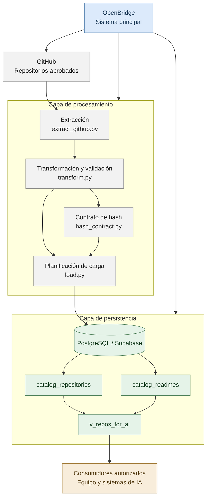
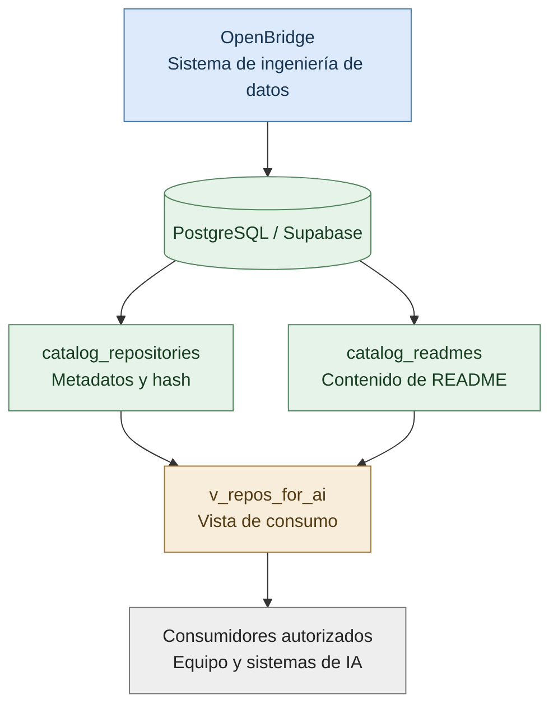
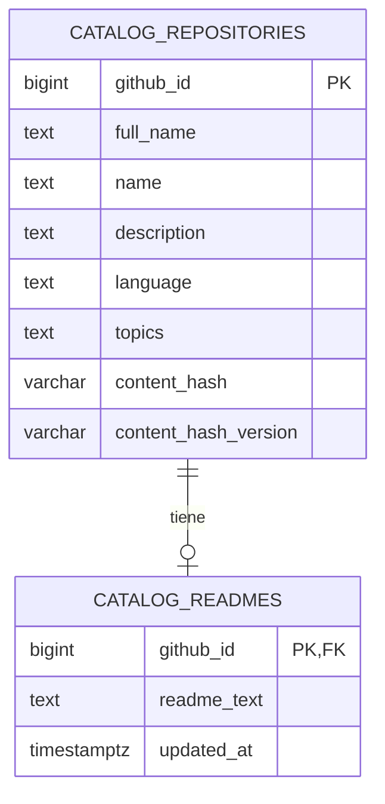

# OpenBridge

**Arquitectura de datos para la gestión de repositorios de GitHub y su integración con inteligencia artificial.**

OpenBridge es un proyecto de ingeniería de datos orientado a extraer, transformar, validar y organizar información de repositorios de GitHub, facilitando su consulta y posterior integración con sistemas de inteligencia artificial.

La arquitectura utiliza PostgreSQL sobre Supabase como almacenamiento central. Separa los metadatos de los repositorios, el contenido de sus archivos README y la interfaz de consulta destinada a los consumidores autorizados.

El proyecto incorpora un contrato de hash versionado para identificar el contenido procesado y mantener un criterio consistente de validación durante la planificación de las cargas.

---

## Tabla de contenidos

1. [Descripción general](#1-descripción-general)
2. [Arquitectura general](#2-arquitectura-general)
3. [Modelo entidad-relación](#3-modelo-entidad-relación)
4. [Contrato de hash](#4-contrato-de-hash)
5. [Vista de consumo para IA](#5-vista-de-consumo-para-ia)
6. [Flujo de procesamiento de datos](#6-flujo-de-procesamiento-de-datos)
7. [Seguridad y control de acceso](#7-seguridad-y-control-de-acceso)
8. [Estructura del proyecto](#8-estructura-del-proyecto)
9. [Estado actual](#9-estado-actual)
10. [Evolución de la arquitectura](#10-evolución-de-la-arquitectura)

---

## 1. Descripción general

OpenBridge organiza la información de un conjunto de repositorios aprobados de GitHub y la expone mediante una estructura de datos diseñada para su consulta por aplicaciones y sistemas de inteligencia artificial.

Sus objetivos principales son:

- Centralizar los metadatos de los repositorios.
- Almacenar el contenido textual de sus README.
- Mantener una relación consistente entre los repositorios y sus documentos.
- Incorporar un contrato de hash que permita identificar el contenido procesado.
- Facilitar el acceso a la información mediante una vista de consulta.
- Separar los permisos de lectura de las operaciones administrativas y de escritura.

El modelo actual se apoya en dos tablas persistentes y una vista de consumo. Esta separación permite administrar los datos de manera estructurada sin obligar a cada consumidor a conocer las relaciones internas de la base de datos.

## 2. Arquitectura general

La arquitectura lógica de OpenBridge se divide en cuatro capas: fuente de datos, procesamiento, persistencia y consumo.



El diagrama representa la arquitectura lógica y las responsabilidades de sus componentes. No implica que todos los procesos se ejecuten automáticamente ni que exista una API desplegada.

### 2.1. Fuente de datos

GitHub es el origen de los metadatos y del contenido documental de los repositorios seleccionados.

La extracción se realiza sobre los repositorios aprobados para el catálogo.

### 2.2. Procesamiento

Los módulos de extracción y transformación organizan los registros y validan su estructura.

El módulo de hash implementa el contrato utilizado para generar y revisar las huellas del contenido. El cargador compara el resultado transformado con el estado existente del catálogo y prepara un plan de carga.

### 2.3. Persistencia

Supabase PostgreSQL almacena los metadatos de los repositorios y sus README en entidades independientes.

La vista `public.v_repos_for_ai` consolida los campos seleccionados para facilitar el consumo.

### 2.4. Consumo

Los integrantes autorizados y los sistemas de IA pueden consultar los datos mediante la vista de lectura.

Esta interfaz permite separar el almacenamiento interno de las necesidades de consulta de los consumidores.

## 3. Modelo entidad-relación

El modelo de datos de OpenBridge se organiza alrededor del sistema principal, que utiliza PostgreSQL como almacenamiento y expone los datos mediante una vista destinada a los consumidores autorizados.

Es importante distinguir entre el modelo conceptual del sistema y el modelo entidad-relación físico: OpenBridge es el sistema que contiene el modelo, mientras que las tablas y sus restricciones representan las entidades reales de PostgreSQL.

### 3.1. Modelo conceptual de OpenBridge



Este diagrama presenta la jerarquía conceptual: OpenBridge organiza la persistencia, las entidades almacenan la información, la vista consolida los datos y los consumidores autorizados acceden a ellos.

### 3.2. Modelo entidad-relación físico

La base de datos contiene dos tablas principales relacionadas mediante `github_id`.



El diagrama muestra los atributos principales del modelo, no la totalidad de las columnas físicas de `catalog_repositories`.

La cardinalidad representa que un repositorio puede tener cero o un registro asociado en `catalog_readmes`, mientras que cada registro de README corresponde a un único repositorio.

### 3.3. Entidad `catalog_repositories`

Es la entidad central del catálogo. Almacena los metadatos disponibles de cada repositorio, incluyendo su identificador, nombre completo, descripción, lenguaje, estadísticas y otros atributos provenientes de GitHub.

Su clave primaria es:

`github_id`

Este identificador permite distinguir los repositorios y relacionarlos con sus respectivos README.

La tabla también contiene los campos `content_hash` y `content_hash_version`, utilizados para representar y versionar la huella del contenido procesado.

### 3.4. Entidad `catalog_readmes`

Almacena el contenido textual de los README asociados a los repositorios.

| Columna | Función |
|---|---|
| `github_id` | Clave primaria y clave foránea hacia `catalog_repositories.github_id`. |
| `readme_text` | Contenido textual del README. |
| `updated_at` | Fecha y hora de actualización registrada. |

La clave foránea establece la integridad referencial entre las tablas. La restricción `ON DELETE CASCADE` hace que la eliminación de un repositorio elimine también el registro asociado en `catalog_readmes`.

La separación entre metadatos y README permite administrar ambos componentes de forma independiente y consultarlos conjuntamente.

### 3.5. Relación con la vista de consumo

La vista `public.v_repos_for_ai` combina los campos seleccionados de `catalog_repositories` y `catalog_readmes` mediante una unión por `github_id`.

La vista no es una tercera tabla de almacenamiento. Es una interfaz de consulta que presenta la información consolidada para los consumidores autorizados.

Esta separación permite que los sistemas consumidores utilicen un contrato de consulta común sin implementar por su cuenta las uniones entre tablas.

## 4. Contrato de hash

El contrato de hash es un componente central de OpenBridge porque permite representar de manera verificable el contenido procesado y establecer reglas consistentes para comparar registros.

La implementación se encuentra en `src/hash_contract.py`.

OpenBridge utiliza SHA-256 sobre una representación JSON canónica del contenido contemplado por el contrato.

### 4.1. Campos del contrato

| Campo | Tipo | Propósito |
|---|---|---|
| `content_hash` | `VARCHAR(64)` | Almacena la huella SHA-256 del contenido procesado. |
| `content_hash_version` | `VARCHAR(32)` | Identifica la versión del contrato de hash utilizada. |

SHA-256 genera una huella hexadecimal de 64 caracteres. La versión del contrato identifica las reglas con las que se construye la representación canónica y se calcula la huella.

### 4.2. ¿Por qué versionar el hash?

Una huella solo puede interpretarse correctamente cuando se conocen las reglas utilizadas para calcularla.

Los cambios en los campos seleccionados, la normalización de los valores o la representación JSON pueden producir un hash diferente incluso cuando el contenido original no haya cambiado de manera significativa.

Por eso, OpenBridge mantiene la versión del contrato separada de la huella.

Esta separación permite:

- Identificar qué contrato se utilizó para generar un hash.
- Evitar comparaciones incorrectas entre versiones incompatibles.
- Tratar de forma diferenciada los registros heredados.
- Controlar la evolución del cálculo de huellas sin asumir que todos los registros históricos utilizan las mismas reglas.

### 4.3. Contrato `openbridge-ai-v1`

La versión identificada en el esquema es:

`openbridge-ai-v1`

Esta versión corresponde al contrato de hash canónico documentado para OpenBridge.

El campo `content_hash_version` admite valores nulos para registros cuya versión de contrato no está identificada.

Un valor nulo no significa necesariamente que el hash sea incorrecto. Indica que no se ha declarado una versión de contrato para ese registro.

Por lo tanto, no deben asignarse versiones automáticamente ni recalcularse las huellas existentes sin validar primero las reglas aplicables.

### 4.4. Estado de los hashes

En la última validación registrada se observaron los siguientes valores:

| Condición | Registros |
|---|---:|
| Repositorios con `content_hash` presente | 100 |
| Registros con versión `openbridge-ai-v1` | 95 |
| Registros con versión nula | 5 |

Estos valores corresponden al estado observado durante esa validación y pueden cambiar si se actualizan los datos.

### 4.5. Hash y planificación de carga

El contrato de hash interviene en la planificación de las cargas de datos.

Antes de decidir si un registro debe actualizarse, es necesario verificar que la huella corresponde al contrato esperado y que las reglas de comparación son compatibles.

El cargador actual mantiene una política conservadora para los registros existentes: no debe actualizar automáticamente los metadatos ni los README sin que el contrato de hash y las reglas de escritura estén aprobados.

Esta política protege la integridad del catálogo y evita cambios que puedan invalidar la interpretación de los hashes existentes.

## 5. Vista de consumo para IA

La vista `public.v_repos_for_ai` es la interfaz de consulta consolidada de OpenBridge.

Su definición combina la información de `catalog_repositories` con el texto asociado de `catalog_readmes`.

### 5.1. Campos expuestos

La vista presenta los siguientes campos:

| Campo | Descripción |
|---|---|
| `github_id` | Identificador del repositorio en GitHub. |
| `full_name` | Nombre completo del repositorio, incluyendo propietario y nombre. |
| `name` | Nombre del repositorio. |
| `description` | Descripción disponible. |
| `homepage` | Sitio web asociado, si existe. |
| `language` | Lenguaje principal registrado. |
| `topics` | Temas asociados, proyectados como arreglo de texto en la vista actual. |
| `stargazers_count` | Número de estrellas. |
| `forks_count` | Número de forks. |
| `pushed_at` | Fecha de la última actividad de envío registrada. |
| `archived` | Indicador de repositorio archivado. |
| `license_spdx_id` | Identificador SPDX de la licencia, si existe. |
| `content_hash` | Huella del contenido procesado. |
| `readme_text` | Contenido textual del README. |

La disponibilidad de algunos campos depende de los metadatos proporcionados por GitHub.

### 5.2. Función de la vista

La vista proporciona una interfaz común para:

- Consultar metadatos y README en una sola operación.
- Reducir la necesidad de que los consumidores conozcan el esquema interno.
- Mantener una proyección controlada de los campos disponibles.
- Separar el almacenamiento de la forma en que se consumen los datos.

La vista expone `content_hash`, pero no `content_hash_version`. Si un consumidor necesita conocer la versión del contrato, ese requisito debe acordarse antes de modificar la interfaz de consumo.

### 5.3. Integración con sistemas de IA

La vista está destinada a facilitar el acceso de los consumidores autorizados a la información del catálogo.

El componente de IA puede utilizar los metadatos y el contenido de los README según sus necesidades de análisis.

La vista constituye la interfaz de datos disponible actualmente. No implica que se haya implementado una API propia ni que exista un servicio de IA desplegado como parte de OpenBridge.

## 6. Flujo de procesamiento de datos

El procesamiento se distribuye entre los módulos de ingeniería de datos.

### 6.1. Extracción

`src/extract_github.py`

Obtiene la información de los repositorios aprobados y prepara los registros extraídos para su procesamiento.

### 6.2. Transformación

`src/transform.py`

Organiza los registros y aplica las validaciones necesarias antes de preparar los datos para la carga.

### 6.3. Cálculo y validación del hash

`src/hash_contract.py`

Implementa el contrato de hash y las funciones asociadas a la generación y previsualización de las huellas.

### 6.4. Planificación de carga

`src/load.py`

Compara el resultado transformado con una instantánea del catálogo existente y genera un plan de carga.

El proceso de planificación no implica por sí mismo la escritura de datos. Las operaciones de escritura requieren una autorización independiente y el cumplimiento del contrato aprobado.

### 6.5. Conexión y configuración

- `src/config.py`: configura y valida los parámetros de conexión.
- `src/database.py`: crea el motor de SQLAlchemy y proporciona la comprobación de conectividad.

Esta separación facilita el mantenimiento de los componentes y permite probar la extracción, transformación, validación y planificación de carga de manera controlada.

## 7. Seguridad y control de acceso

OpenBridge utiliza Supabase PostgreSQL como almacenamiento central.

Para las consultas rutinarias se creó y validó el usuario de lectura `openbridge_ai_reader`.

Según las comprobaciones registradas, esta cuenta:

- Puede consultar `public.v_repos_for_ai`.
- No tiene permisos de inserción, actualización ni eliminación.
- No tiene acceso directo a `catalog_repositories` ni a `catalog_readmes`.
- No puede crear objetos en el esquema.

La separación de permisos permite que los consumidores consulten la información sin recibir permisos administrativos sobre el catálogo.

Las operaciones de escritura, los cambios de esquema y las modificaciones de permisos deben mantenerse separados de las credenciales de consulta.

Las credenciales se administran fuera de este documento. No deben almacenarse en el README, en archivos públicos del repositorio ni en el control de versiones.

Los permisos deben volver a verificarse después de cualquier cambio administrativo relevante.

## 8. Estructura del proyecto

Los componentes principales de ingeniería de datos se encuentran en `data-engineering/`.

```text
OpenBridge/
├── README.md
├── .gitignore
└── data-engineering/
    ├── docs/
    │   ├── ADR-001_content_hash_v1.md
    │   └── ADR-003_topics_para_IA_v1.md
    ├── scripts/
    │   └── ...
    ├── sql/
    │   └── ...
    ├── src/
    │   ├── config.py
    │   ├── database.py
    │   ├── extract_github.py
    │   ├── transform.py
    │   ├── hash_contract.py
    │   └── load.py
    ├── tests/
    │   └── ...
    └── requirements.txt
```

La estructura es representativa y puede evolucionar a medida que se incorporen nuevos componentes.

### Módulos principales

| Módulo | Responsabilidad |
|---|---|
| `extract_github.py` | Extracción de información de GitHub. |
| `transform.py` | Transformación y validación de registros. |
| `hash_contract.py` | Contrato y validación de las huellas de contenido. |
| `load.py` | Comparación con el catálogo y planificación de carga. |
| `database.py` | Motor de conexión a PostgreSQL. |
| `config.py` | Configuración de los parámetros de conexión. |

Los documentos de arquitectura y las decisiones técnicas deben mantenerse alineados con los cambios que se realicen en los módulos y en el esquema.

Los archivos SQL deben revisarse antes de ejecutarse, especialmente los que correspondan a candidatos, pruebas o aplicación de cambios.

## 9. Estado actual

Según las últimas validaciones registradas durante la configuración:

| Componente | Estado |
|---|---|
| Base de datos PostgreSQL en Supabase | Conexión validada |
| Repositorios almacenados | 100 |
| README almacenados | 100 |
| Filas visibles en `public.v_repos_for_ai` | 100 |
| Repositorios con hash presente | 100 |
| Usuario de lectura | Creado y validado |
| Permisos de modificación del usuario lector | No concedidos |
| Pruebas automatizadas | 186 aprobadas en la última ejecución registrada |
| API propia de OpenBridge | Pendiente de desarrollo |

Los resultados representan el estado observado en las validaciones realizadas. No constituyen una garantía de que los datos, permisos o pruebas permanezcan invariables después de nuevas modificaciones.

## 10. Evolución de la arquitectura

La evolución del proyecto debe priorizar la integridad del catálogo, la estabilidad del contrato de hash y la claridad de la interfaz de consumo.

Las siguientes etapas constituyen una ruta de desarrollo propuesta.

### 10.1. Consolidación del modelo de datos

Mantener documentadas las entidades, las relaciones, las restricciones y la estructura de la vista.

Los cambios de esquema deben revisarse y validarse antes de aplicarse a la base de datos.

### 10.2. Evolución del contrato de hash

Mantener un criterio explícito para la versión del hash, los registros heredados y las reglas de comparación.

Cualquier cambio en la representación canónica debe documentarse como una evolución del contrato y someterse a pruebas antes de utilizarse en las cargas.

### 10.3. Integración con consumidores

Acordar con los responsables de los componentes consumidores qué campos necesitan, cómo consultarán la vista y qué requisitos adicionales de acceso o validación deben cumplirse.

### 10.4. Evaluación de una API

Una API propia puede incorporarse si el equipo necesita una interfaz HTTP común para múltiples aplicaciones o servicios.

En ese caso, deberá definirse por separado su contrato, autenticación, autorización, validación de parámetros y política de exposición de datos.

La API no forma parte del estado implementado que se documenta actualmente.

### 10.5. Mantenimiento y control de cambios

Mantener las pruebas automatizadas, revisar los permisos después de los cambios administrativos y documentar las decisiones que afecten al modelo de datos.

El objetivo es que la arquitectura pueda evolucionar sin perder la integridad de los registros ni la compatibilidad de la interfaz de consumo.

---

**OpenBridge: datos estructurados, relaciones explícitas, contenido versionado y acceso controlado para la integración con inteligencia artificial.**
