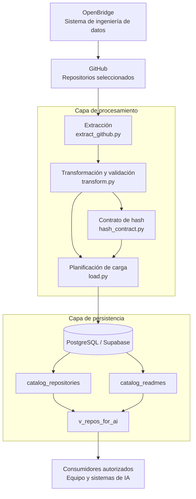
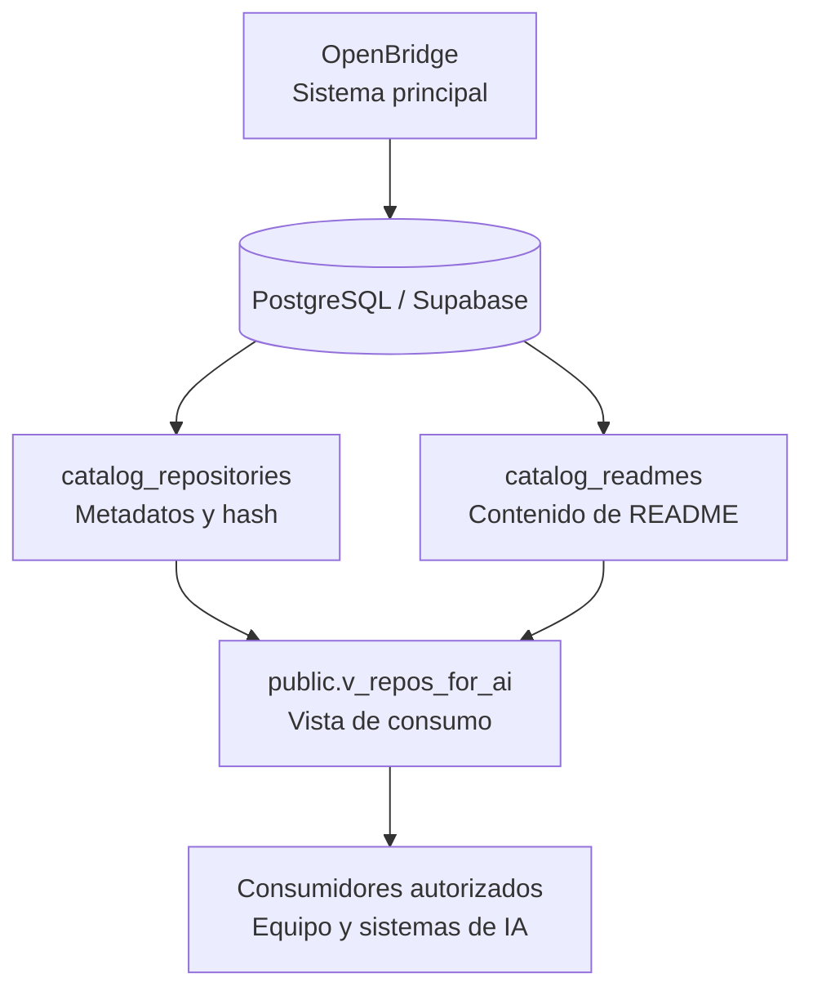
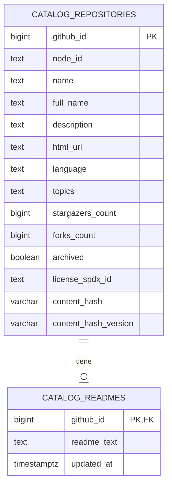

# OpenBridge — Data Engineering

**Arquitectura, modelo de datos, integridad, acceso controlado y gestión de privacidad**

OpenBridge es un proyecto de ingeniería de datos orientado a recopilar, transformar, validar, relacionar y organizar información sobre repositorios de software de código abierto. Su arquitectura permite consultar un catálogo estructurado y facilita su integración con aplicaciones y sistemas de inteligencia artificial.

El componente de datos utiliza PostgreSQL sobre Supabase como almacenamiento central. Separa los metadatos de los repositorios, el contenido de sus archivos README y la vista de consulta destinada a los consumidores autorizados.

La arquitectura incorpora un contrato de hash versionado para identificar el contenido procesado, controles de acceso de solo lectura y una interfaz de consulta común para los componentes que necesitan utilizar el catálogo.

La documentación también establece una línea de trabajo para gestionar la privacidad de la información, tomando como referencia ISO/IEC 27701:2025. Esta inclusión representa un marco de trabajo propuesto y no una declaración de conformidad o certificación.

---

## Tabla de contenidos

1. [Descripción general](#1-descripción-general)
2. [Arquitectura general](#2-arquitectura-general)
3. [Modelo entidad-relación](#3-modelo-entidad-relación)
4. [Entidades y relaciones](#4-entidades-y-relaciones)
5. [Contrato de hash](#5-contrato-de-hash)
6. [Vista de consumo para IA](#6-vista-de-consumo-para-ia)
7. [Flujo de procesamiento de datos](#7-flujo-de-procesamiento-de-datos)
8. [Calidad e integridad de los datos](#8-calidad-e-integridad-de-los-datos)
9. [Seguridad y control de acceso](#9-seguridad-y-control-de-acceso)
10. [Privacidad y referencia ISO/IEC 27701:2025](#10-privacidad-y-referencia-isoiec-277012025)
11. [Notebooks y exploración de datos](#11-notebooks-y-exploración-de-datos)
12. [Estructura del proyecto](#12-estructura-del-proyecto)
13. [Estado actual](#13-estado-actual)
14. [Evolución de la arquitectura](#14-evolución-de-la-arquitectura)
15. [Conexión de los integrantes del equipo](#15-conexión-de-los-integrantes-del-equipo)
16. [Referencias y documentación relacionada](#16-referencias-y-documentación-relacionada)

---

## 1. Descripción general

OpenBridge organiza información técnica procedente de repositorios de GitHub para facilitar su consulta, análisis y posterior integración con componentes de inteligencia artificial.

El componente de ingeniería de datos tiene los siguientes objetivos:

- Centralizar los metadatos de los repositorios seleccionados.
- Almacenar el contenido textual de los archivos README.
- Mantener la integridad referencial entre los repositorios y sus documentos.
- Identificar el contenido procesado mediante un contrato de hash versionado.
- Validar los registros antes de planificar operaciones de carga.
- Exponer una vista de consulta común para los consumidores autorizados.
- Separar los permisos de lectura de las operaciones administrativas y de escritura.
- Documentar los riesgos relacionados con la seguridad, la privacidad y el uso posterior de la información.

### 1.1. Alcance actual

El modelo documentado comprende dos tablas principales y una vista de consumo:

| Objeto | Tipo | Responsabilidad |
|---|---|---|
| `catalog_repositories` | Tabla | Almacenar los metadatos de los repositorios y los campos del contrato de hash. |
| `catalog_readmes` | Tabla | Almacenar el contenido textual de los README. |
| `v_repos_for_ai` | Vista | Consolidar los campos seleccionados para su consulta por consumidores autorizados. |

La arquitectura se encuentra preparada para facilitar el acceso a los datos. La existencia de la vista no implica que ya exista una API propia desplegada ni que todos los componentes consumidores estén integrados.

### 1.2. Principios de diseño

OpenBridge adopta los siguientes principios para el componente de datos:

- **Identidad:** conservar los identificadores originales de las fuentes.
- **Integridad:** establecer relaciones y restricciones explícitas.
- **Trazabilidad:** documentar el origen y las transformaciones de la información.
- **Consistencia:** mantener contratos definidos para los datos y sus hashes.
- **Separación de responsabilidades:** distinguir la extracción, la transformación, la persistencia y el consumo.
- **Privilegios mínimos:** conceder a cada consumidor únicamente los permisos que necesita.
- **Privacidad desde el diseño:** evaluar la información personal que pudiera aparecer en los metadatos o documentos y reducir los riesgos de su tratamiento.

---

## 2. Arquitectura general

La arquitectura lógica se divide en cuatro capas principales: fuente, procesamiento, persistencia y consumo.



El diagrama representa la organización lógica de las responsabilidades. No implica que todos los procesos se ejecuten automáticamente ni que exista un servicio de API desplegado.

### 2.1. Fuente de datos

GitHub es la fuente de los metadatos y del contenido documental de los repositorios seleccionados.

Los registros de origen deben conservar los identificadores necesarios para relacionar los datos con su fuente y permitir verificaciones posteriores.

### 2.2. Procesamiento

La capa de procesamiento comprende:

- Extracción de información.
- Transformación y normalización.
- Validación de los registros.
- Cálculo y verificación de hashes.
- Comparación con el estado existente del catálogo.
- Planificación de las operaciones de carga.

El procesamiento debe permitir identificar diferencias entre los datos obtenidos y los datos almacenados sin ejecutar escrituras automáticamente cuando no exista autorización.

### 2.3. Persistencia

Supabase PostgreSQL almacena los metadatos de los repositorios y sus README en tablas independientes.

La vista `public.v_repos_for_ai` proporciona una representación consolidada para los consumidores que tienen permisos de lectura.

### 2.4. Consumo

Los componentes autorizados pueden consultar el catálogo a través de la vista.

La integración puede realizarse mediante un cliente PostgreSQL con permisos limitados o mediante una API que actúe como intermediaria.

La API propia de OpenBridge es una evolución propuesta y no debe confundirse con la vista SQL ya existente.

---

## 3. Modelo entidad-relación

El modelo de datos debe distinguir entre el sistema OpenBridge, la infraestructura de persistencia, las entidades físicas y los consumidores de información.

### 3.1. Modelo conceptual de OpenBridge



OpenBridge representa el sistema que organiza el flujo de datos. PostgreSQL proporciona la persistencia; las tablas almacenan las entidades; la vista consolida la información y los consumidores autorizados acceden a ella.

### 3.2. Modelo entidad-relación físico

Las tablas principales se relacionan mediante el identificador `github_id`.



El diagrama muestra los atributos principales, no todas las columnas físicas de `catalog_repositories`.

La cardinalidad representa que un repositorio puede tener cero o un README almacenado, mientras que cada registro de README pertenece a un único repositorio.

La vista `v_repos_for_ai` no se representa como una entidad física adicional porque no constituye una tercera tabla de almacenamiento.

---

## 4. Entidades y relaciones

### 4.1. `catalog_repositories`

Es la entidad central del catálogo.

Almacena los metadatos disponibles de cada repositorio, incluyendo identificadores, nombres, URLs, descripción, estadísticas, lenguaje, licencia, información del propietario, fechas y atributos adicionales procedentes de GitHub.

Su clave primaria es `github_id`, que identifica de manera única cada repositorio dentro de este catálogo.

Entre sus columnas relevantes se encuentran:

| Columna | Propósito |
|---|---|
| `github_id` | Identificador numérico del repositorio en GitHub y clave primaria. |
| `node_id` | Identificador de tipo nodo proporcionado por GitHub. |
| `name` | Nombre del repositorio. |
| `full_name` | Nombre completo del repositorio, incluyendo propietario y nombre. |
| `description` | Descripción disponible. |
| `html_url` | URL web del repositorio. |
| `language` | Lenguaje principal registrado. |
| `topics` | Temas asociados al repositorio. |
| `stargazers_count` | Número de estrellas. |
| `forks_count` | Número de forks. |
| `archived` | Indicador de repositorio archivado. |
| `license_spdx_id` | Identificador SPDX de la licencia, cuando existe. |
| `content_hash` | Huella del contenido procesado. |
| `content_hash_version` | Versión del contrato utilizada para calcular la huella. |

La tabla contiene otras columnas de metadatos de GitHub que no se enumeran aquí. El esquema físico y el código fuente deben utilizarse como referencia para el diccionario de datos completo.

### 4.2. `catalog_readmes`

Esta entidad almacena el contenido textual de los README asociados a los repositorios.

| Columna | Tipo | Propósito |
|---|---|---|
| `github_id` | `BIGINT` | Clave primaria y clave foránea hacia `catalog_repositories.github_id`. |
| `readme_text` | `TEXT` | Contenido textual del README. |
| `updated_at` | `TIMESTAMPTZ` | Fecha y hora de actualización, con valor predeterminado `CURRENT_TIMESTAMP`. |

La clave foránea garantiza que cada README almacenado corresponda a un repositorio existente.

La restricción `ON DELETE CASCADE` hace que, al eliminar un repositorio, también se elimine su registro asociado de README.

### 4.3. Integridad referencial

La relación se implementa mediante:

- Una clave primaria en `catalog_repositories.github_id`.
- Una clave primaria en `catalog_readmes.github_id`.
- Una clave foránea desde `catalog_readmes.github_id` hacia `catalog_repositories.github_id`.
- Una política de eliminación en cascada para los README asociados.

Esta estructura impide duplicar el identificador de un repositorio en cada tabla y permite comprobar la correspondencia entre las dos entidades.

### 4.4. Vista de consumo

La vista `public.v_repos_for_ai` combina campos seleccionados de ambas tablas mediante una unión por `github_id`.

La vista proporciona una interfaz común para consultar los datos sin obligar a cada consumidor a implementar las uniones entre las tablas.

---

## 5. Contrato de hash

El contrato de hash permite representar de manera consistente el contenido procesado y comparar registros bajo unas reglas definidas.

La implementación se encuentra en `src/hash_contract.py`.

OpenBridge utiliza SHA-256 sobre una representación JSON canónica del contenido contemplado por el contrato.

### 5.1. Campos del contrato

| Campo | Tipo | Propósito |
|---|---|---|
| `content_hash` | `VARCHAR(64)` | Almacena la huella SHA-256 en formato hexadecimal. |
| `content_hash_version` | `VARCHAR(32)` | Identifica la versión del contrato utilizada. |

SHA-256 genera una huella hexadecimal de 64 caracteres.

La versión del contrato identifica las reglas utilizadas para construir la representación canónica del contenido y calcular su huella.

### 5.2. ¿Por qué versionar el hash?

Una huella solo puede interpretarse correctamente cuando se conocen las reglas con las que fue calculada.

Cambios en la selección de campos, la normalización de valores o la representación JSON pueden producir un hash diferente aunque el contenido original no haya cambiado de forma significativa.

Versionar el contrato permite:

- Identificar las reglas aplicadas a cada huella.
- Evitar comparaciones entre versiones incompatibles.
- Tratar de forma diferenciada los registros heredados.
- Evolucionar el cálculo de hashes mediante cambios documentados y probados.
- Reducir el riesgo de actualizar registros por diferencias producidas únicamente por el contrato.

### 5.3. Contrato `openbridge-ai-v1`

El esquema documenta la versión `openbridge-ai-v1`.

El campo `content_hash_version` admite valores nulos para los registros cuya versión de contrato no está identificada.

Un valor nulo no demuestra que el hash sea incorrecto. Significa que no se ha declarado una versión de contrato para ese registro.

Por tanto, no deben asignarse versiones automáticamente ni recalcularse las huellas existentes sin validar primero las reglas aplicables.

### 5.4. Estado observado

En la última validación registrada se obtuvieron estos valores:

| Condición | Registros |
|---|---:|
| Repositorios con hash presente | 100 |
| Registros con versión `openbridge-ai-v1` | 95 |
| Registros con versión nula | 5 |

Estos valores corresponden al estado observado durante la validación y deben volver a comprobarse después de modificaciones del catálogo.

### 5.5. Hash, integridad y privacidad

El hash se utiliza para identificar contenido según un contrato definido. No sustituye un mecanismo de cifrado, no controla el acceso y no constituye por sí mismo una técnica de anonimización.

Una huella puede permitir relacionar registros o reconocer que dos contenidos producen el mismo resultado bajo las mismas reglas.

Por ello, `content_hash` debe considerarse un mecanismo de integridad y comparación, no una garantía de privacidad.

### 5.6. Relación con la planificación de carga

Antes de actualizar un registro, el cargador debe verificar que la huella corresponde al contrato esperado y que las reglas de comparación son compatibles.

Los registros heredados cuya versión de hash sea nula requieren un tratamiento explícito.

La planificación de carga no autoriza por sí misma a modificar el catálogo. Las operaciones de escritura deben respetar las reglas y autorizaciones aprobadas.

---

## 6. Vista de consumo para IA

La vista `public.v_repos_for_ai` es la interfaz de consulta consolidada de OpenBridge.

Combina los campos seleccionados de `catalog_repositories` y el contenido textual asociado de `catalog_readmes`.

### 6.1. Campos expuestos

| Campo | Descripción |
|---|---|
| `github_id` | Identificador del repositorio en GitHub. |
| `full_name` | Nombre completo del repositorio. |
| `name` | Nombre del repositorio. |
| `description` | Descripción disponible. |
| `homepage` | Sitio web asociado, si existe. |
| `language` | Lenguaje principal registrado. |
| `topics` | Temas asociados, proyectados como arreglo de texto en la vista. |
| `stargazers_count` | Número de estrellas. |
| `forks_count` | Número de forks. |
| `pushed_at` | Fecha de la última actividad de envío registrada. |
| `archived` | Indicador de repositorio archivado. |
| `license_spdx_id` | Identificador SPDX de la licencia, si existe. |
| `content_hash` | Huella del contenido procesado. |
| `readme_text` | Contenido textual del README. |

La proyección de `topics` como arreglo debe mantenerse coherente con el contrato acordado por los componentes consumidores. El tipo físico de almacenamiento y el tipo expuesto por la vista deben verificarse cuando se realicen cambios de esquema.

### 6.2. Función de la vista

La vista permite:

- Consultar metadatos y README en una sola operación.
- Reducir el acoplamiento entre los consumidores y las tablas internas.
- Mantener una proyección controlada de los campos disponibles.
- Facilitar la integración con herramientas de análisis y sistemas de IA.
- Separar los permisos de consulta de los permisos administrativos sobre las tablas.

### 6.3. Relación con el componente de IA

Los sistemas de IA autorizados pueden utilizar los metadatos y el contenido de los README para realizar análisis sobre los repositorios.

La vista constituye la interfaz de datos actualmente disponible. No implica que se haya implementado una API propia, un sistema de embeddings o un servicio de recomendaciones desplegado.

Si un consumidor necesita campos adicionales, como la versión del hash, el requisito debe acordarse y documentarse antes de modificar la interfaz.

---

## 7. Flujo de procesamiento de datos

Los módulos de ingeniería de datos distribuyen las responsabilidades del pipeline.

| Módulo | Responsabilidad |
|---|---|
| `src/extract_github.py` | Extraer información de GitHub. |
| `src/transform.py` | Organizar, normalizar y validar los registros. |
| `src/hash_contract.py` | Implementar el contrato de hash y las funciones asociadas. |
| `src/load.py` | Comparar el resultado transformado con el catálogo y planificar la carga. |
| `src/database.py` | Gestionar el motor de conexión a PostgreSQL. |
| `src/config.py` | Configurar y validar los parámetros de conexión. |

El flujo lógico es:

1. Obtener los registros de la fuente.
2. Transformar y validar los datos.
3. Aplicar el contrato de hash correspondiente.
4. Comparar los resultados con el estado actual del catálogo.
5. Revisar el plan de carga.
6. Ejecutar escrituras únicamente cuando estén autorizadas y se hayan validado las condiciones correspondientes.
7. Verificar el resultado y documentar las incidencias.

La planificación de carga no implica por sí misma que se escriban datos. Los cambios de esquema y las modificaciones persistentes requieren una revisión independiente.

---

## 8. Calidad e integridad de los datos

La calidad del catálogo debe verificarse mediante pruebas automatizadas y consultas de validación.

### 8.1. Controles principales

| Control | Objetivo |
|---|---|
| Unicidad de `github_id` | Evitar duplicados en el catálogo. |
| Integridad referencial | Evitar README sin un repositorio asociado. |
| Integridad del README | Verificar que el contenido esperado esté presente. |
| Integridad del hash | Validar formato y compatibilidad del contrato. |
| Coherencia de la vista | Comprobar que la vista devuelve los registros esperados. |
| Tipos de datos | Verificar que los campos cumplen el contrato. |
| Permisos | Confirmar que los consumidores solo acceden a los objetos autorizados. |

### 8.2. Resultados de validación registrados

En las últimas validaciones compartidas se observaron estos resultados:

| Indicador | Resultado |
|---|---:|
| Repositorios | 100 |
| README | 100 |
| Filas de la vista de consumo | 100 |
| Identificadores únicos en la vista | 100 |
| README vacíos | 0 |
| README huérfanos | 0 |
| Repositorios con hash presente | 100 |

Las pruebas automatizadas también registraron 186 pruebas aprobadas en una ejecución.

Estos resultados son evidencias de las ejecuciones realizadas, no una garantía permanente del estado del sistema. Deben repetirse después de cambios en el código, los permisos o el esquema.

---

## 9. Seguridad y control de acceso

OpenBridge utiliza Supabase PostgreSQL como almacenamiento central.

Para las consultas rutinarias se creó y validó el usuario de lectura `openbridge_ai_reader`.

Según las comprobaciones registradas, esta cuenta:

- Puede consultar `public.v_repos_for_ai`.
- No tiene permisos de inserción, actualización ni eliminación.
- No tiene acceso directo a `catalog_repositories` ni a `catalog_readmes`.
- No puede crear objetos en el esquema.

Esta separación permite que los consumidores consulten la información sin recibir permisos administrativos sobre el catálogo.

### 9.1. Principio de privilegios mínimos

Cada componente debe utilizar una identidad con los permisos estrictamente necesarios para su función.

El usuario de lectura no debe utilizarse para operaciones de escritura. Si un servicio requiere guardar resultados, deberá acordarse una identidad y una política de permisos específicas para esa responsabilidad.

### 9.2. Gestión de credenciales

Las credenciales deben mantenerse fuera del código fuente y de la documentación pública.

Se recomienda:

- Utilizar variables de entorno o un gestor de secretos.
- Mantener los archivos locales de configuración excluidos del control de versiones.
- Revisar el historial de Git antes de publicar cambios.
- No incluir contraseñas en notebooks, capturas, archivos SQL ni README.
- Evitar el uso de cuentas administrativas en las consultas rutinarias.
- Rotar los secretos cuando exista una sospecha de exposición.

La presencia de reglas en `.gitignore` no demuestra por sí sola que nunca se haya subido un secreto al repositorio; esa condición debe verificarse por separado.

### 9.3. Conexión segura de los consumidores

Los clientes PostgreSQL deben utilizar SSL y las credenciales autorizadas.

La conexión directa está destinada a pruebas y consultas controladas. Para una aplicación web, el navegador no debe conectarse a PostgreSQL utilizando las credenciales del catálogo.

Cuando se implemente el backend, este deberá gestionar la conexión a Supabase desde el servidor y exponer únicamente los datos autorizados mediante una API.

---

## 10. Privacidad y referencia ISO/IEC 27701:2025

### 10.1. Objetivo

OpenBridge incorpora la gestión de privacidad como una línea de trabajo de su arquitectura de datos.

La referencia es **ISO/IEC 27701:2025**, norma internacional que establece requisitos y orientación para los sistemas de gestión de información de privacidad, conocidos como PIMS (*Privacy Information Management System*).

Referencia oficial: [ISO/IEC 27701:2025 — ISO](https://www.iso.org/standard/27701).

Esta norma aborda la gestión responsable de la información de identificación personal y las responsabilidades relacionadas con su tratamiento.

La inclusión de esta referencia en OpenBridge pretende orientar el diseño, la evaluación de riesgos y la documentación de los controles de privacidad.

**Estado:** alineación documental propuesta. No se afirma que OpenBridge cumpla íntegramente la norma, haya superado una auditoría de conformidad o disponga de una certificación.

### 10.2. ¿Por qué es relevante para OpenBridge?

El catálogo está centrado en repositorios de software, no en perfiles de usuarios finales. Sin embargo, los metadatos y documentos públicos pueden contener información relacionada con personas.

Por ejemplo:

- Nombres de propietarios o mantenedores.
- Identificadores de cuentas públicas.
- Nombres o datos de contacto incluidos en los README.
- Direcciones de correo electrónico publicadas en documentación.
- Referencias a personas dentro de archivos documentales.

Que un dato esté disponible públicamente no significa que cualquier uso posterior carezca de riesgos de privacidad.

Por ello, la evaluación debe considerar la información efectivamente almacenada, los campos expuestos por la vista y los tratamientos adicionales que realicen los componentes de IA.

### 10.3. Alcance inicial de privacidad

La revisión propuesta comprende:

1. La extracción de metadatos desde GitHub.
2. El almacenamiento de metadatos en `catalog_repositories`.
3. El almacenamiento del contenido de README en `catalog_readmes`.
4. La proyección de campos mediante `public.v_repos_for_ai`.
5. El acceso del equipo y de los consumidores autorizados.
6. La eventual transferencia de información a servicios de IA.
7. La retención, actualización y eliminación de información cuando corresponda.

El alcance definitivo debe ser aprobado por el equipo y ajustarse a los tratamientos que realmente se implementen.

### 10.4. Inventario y minimización de datos

La primera medida consiste en documentar qué información se recoge y por qué es necesaria.

Para cada campo relevante se recomienda registrar:

| Elemento | Pregunta de control |
|---|---|
| Fuente | ¿De qué fuente procede el dato? |
| Finalidad | ¿Para qué se necesita? |
| Necesidad | ¿Es indispensable para el catálogo o el análisis? |
| Exposición | ¿Qué consumidores pueden consultarlo? |
| Retención | ¿Durante cuánto tiempo debe conservarse? |
| Sensibilidad | ¿Puede contener información personal o confidencial? |
| Eliminación | ¿Cómo se corregirá o eliminará cuando corresponda? |

La vista de consumo ya limita los campos que se exponen a los lectores. Sin embargo, esto no sustituye una revisión del contenido de los README ni del resto de las columnas almacenadas.

La minimización debe considerar tanto la selección de campos como el contenido textual que se procesa.

### 10.5. Controles de privacidad propuestos

La siguiente matriz distingue las medidas observadas de las acciones que requieren implementación o evidencia adicional.

| Área | Control propuesto | Estado documental |
|---|---|---|
| Inventario | Identificar los campos y fuentes que pueden contener información personal. | Requiere revisión específica de privacidad. |
| Finalidad | Documentar el propósito de cada tratamiento. | Propuesto. |
| Minimización | Evitar recopilar o exponer campos innecesarios. | Parcial; existe una vista con campos seleccionados. |
| Acceso | Limitar las consultas al catálogo mediante permisos específicos. | Usuario lector creado y validado. |
| Secretos | Mantener las credenciales fuera del código público. | Configuración local preparada; debe verificarse el historial de Git. |
| Exactitud | Facilitar la corrección de datos incorrectos cuando corresponda. | Procedimiento pendiente de documentar. |
| Retención | Definir criterios de conservación y eliminación. | Pendiente. |
| Derechos de las personas | Definir cómo gestionar solicitudes aplicables. | Pendiente de evaluación. |
| Incidentes | Establecer un procedimiento de respuesta ante exposiciones o accesos indebidos. | Pendiente. |
| Proveedores | Revisar las condiciones de tratamiento y seguridad de los servicios utilizados. | Pendiente de evaluación documental. |
| IA y terceros | Determinar qué información puede enviarse a servicios externos y bajo qué condiciones. | Pendiente de acordar con el componente de IA. |
| Auditoría | Mantener evidencias de revisiones, permisos y decisiones. | Existen evidencias técnicas parciales. |

Esta matriz es un instrumento de trabajo para organizar las actividades de privacidad. No representa una lista exhaustiva de requisitos de la norma ni una auditoría formal.

### 10.6. Responsabilidades sobre la información

Las funciones de las partes deben definirse antes de establecer compromisos de cumplimiento.

El equipo debe determinar, según los fines, los medios y las condiciones reales del tratamiento:

- Quién decide para qué se procesan los datos.
- Quién realiza las operaciones de tratamiento.
- Qué responsabilidad tienen los proveedores de infraestructura.
- Qué responsabilidades corresponden a los servicios de IA.
- Quién autoriza el acceso, la conservación y la eliminación.
- Quién atiende las solicitudes e incidentes relacionados con privacidad.

La asignación de responsabilidades legales no debe inferirse únicamente de la arquitectura técnica.

### 10.7. Hash, acceso y privacidad

Los controles deben interpretarse según su finalidad:

- El hash permite identificar contenido bajo reglas definidas; no anonimiza los datos.
- La vista de lectura reduce la exposición de las tablas internas; no elimina la información personal que pueda aparecer en los campos expuestos.
- El control de acceso limita quién puede consultar los datos; no define por sí solo la finalidad ni el periodo de conservación.
- SSL protege la comunicación de la conexión; no sustituye las medidas de privacidad del tratamiento.
- La documentación ayuda a demostrar decisiones y controles, pero no sustituye su implementación ni su verificación.

### 10.8. Plan de trabajo para la alineación

Se propone avanzar en el siguiente orden:

1. **Inventario:** identificar los datos almacenados y los campos que pueden contener información personal.
2. **Evaluación:** analizar los riesgos de los README, los metadatos y los usos posteriores de la información.
3. **Responsabilidades:** acordar los roles del equipo y las condiciones de los proveedores.
4. **Controles:** revisar acceso, minimización, retención, eliminación y tratamiento por servicios de IA.
5. **Evidencias:** documentar pruebas, decisiones, responsables y acciones correctivas.
6. **Revisión:** contrastar la documentación y los controles con la edición vigente de ISO/IEC 27701 y con las obligaciones legales aplicables.

La revisión detallada debe basarse en el texto oficial de la norma. Este documento no reproduce su contenido normativo ni pretende sustituir una evaluación profesional de conformidad.

---

## 11. Notebooks y exploración de datos

Las notebooks funcionan como un entorno de exploración, análisis y validación previo a la consolidación de decisiones en el código y la documentación del proyecto.

En el trabajo de OpenBridge se ha utilizado la exploración para estudiar el contrato de datos, la interfaz de consumo y la integridad relacional.

Entre los artefactos identificados se encuentran:

- `04_eda_y_contrato_ia.ipynb`: trabajo de exploración y definición de la interfaz entre PostgreSQL y los consumidores de IA.
- La auditoría relacional de solo lectura: revisión del esquema, las claves, las relaciones, los permisos y la integridad del catálogo.

Las notebooks deben permitir distinguir entre observaciones obtenidas de los datos, hipótesis, decisiones acordadas y funcionalidades implementadas.

### 11.1. Relación con ISO/IEC 27701

La documentación disponible no permite confirmar que exista una evaluación completa de ISO/IEC 27701 dentro de las notebooks.

Por tanto, esta sección de privacidad se incorpora como una línea de trabajo documental y debe contrastarse con el contenido real de las notebooks antes de afirmar que ya se realizó ese análisis.

Si se desarrolla una notebook específica de privacidad, debería documentar:

- Objetivo y alcance de la revisión.
- Fuentes y campos examinados.
- Presencia potencial de información personal.
- Riesgos identificados.
- Controles existentes y sus evidencias.
- Acciones pendientes.
- Limitaciones de la evaluación.
- Referencias a la norma y a las decisiones del equipo.

Las notebooks no deben contener contraseñas, tokens ni otros secretos. Tampoco deben utilizarse como sustituto de los procesos de producción o de los controles de acceso.

---

## 12. Estructura del proyecto

Los componentes principales de ingeniería de datos se encuentran en `data-engineering/`.

```text
OpenBridge/
├── README.md
├── .gitignore
└── data-engineering/
    ├── docs/
    │   ├── ADR-001_content_hash_v1.md
    │   └── ADR-003_topics_para_IA_v1.md
    ├── notebooks/
    │   └── ...
    ├── scripts/
    │   └── ...
    ├── sql/
    │   └── ...
    ├── src/
    │   ├── config.py
    │   ├── database.py
    │   ├── extract_github.py
    │   ├── transform.py
    │   ├── hash_contract.py
    │   └── load.py
    ├── tests/
    │   └── ...
    ├── requirements.txt
    └── README.md
```

La estructura es representativa y puede evolucionar a medida que se incorporen nuevos componentes.

Los archivos SQL deben revisarse antes de ejecutarse, especialmente aquellos que correspondan a candidatos, pruebas o aplicación de cambios.

Los documentos de decisión deben conservar el motivo de las modificaciones que afecten al modelo de datos o a los contratos de integración.

---

## 13. Estado actual

Según las validaciones registradas durante la configuración del proyecto:

| Componente | Estado observado |
|---|---|
| PostgreSQL sobre Supabase | Conexión validada. |
| Repositorios almacenados | 100. |
| README almacenados | 100. |
| Filas en `public.v_repos_for_ai` | 100. |
| Repositorios con hash presente | 100. |
| Versiones `openbridge-ai-v1` | 95. |
| Versiones de hash nulas | 5. |
| Usuario de lectura | Creado y validado. |
| Permisos de modificación del usuario lector | No concedidos. |
| Pruebas automatizadas | 186 aprobadas en la última ejecución registrada. |
| API propia de OpenBridge | Pendiente de desarrollo. |
| Frontend integrado | Pendiente de desarrollo e integración. |
| Alineación con ISO/IEC 27701:2025 | Propuesta documental; evaluación pendiente. |

Los resultados representan el estado observado en las validaciones realizadas. No garantizan que los datos, permisos o pruebas permanezcan invariables después de nuevas modificaciones.

---

## 14. Evolución de la arquitectura

La evolución debe priorizar la integridad del catálogo, la estabilidad de los contratos, la seguridad y la facilidad de integración.

### 14.1. Consolidación del modelo

Mantener documentadas las entidades, relaciones, restricciones y tipos de datos.

Los cambios del esquema deben revisarse y validarse antes de aplicarse a la base de datos compartida.

### 14.2. Evolución del contrato de hash

Cualquier cambio en la representación canónica debe documentarse como una evolución del contrato y someterse a pruebas.

Los registros heredados necesitan un tratamiento explícito para evitar comparaciones incompatibles.

### 14.3. Integración con consumidores

Acordar con los responsables del frontend y de IA:

- Qué campos necesitan.
- Cómo consultarán el catálogo.
- Qué formato de respuesta esperan.
- Qué permisos requiere cada componente.
- Qué resultados generados por IA deben persistirse y dónde.

### 14.4. API propia

Una API REST puede actuar como interfaz común entre el catálogo, el frontend y los servicios de IA.

Si se implementa, deberá contar con un contrato documentado, validación de parámetros, manejo consistente de errores, autenticación cuando corresponda y controles de acceso.

La API no forma parte del estado implementado descrito en este documento.

### 14.5. Privacidad y mantenimiento

La gestión de privacidad debe evolucionar junto con el catálogo.

Los cambios en las fuentes, los campos expuestos, los servicios de IA y los proveedores pueden modificar los riesgos del tratamiento. Por ello, el inventario y la evaluación deben revisarse cuando cambie el alcance del sistema.

---

## 15. Conexión de los integrantes del equipo

Los integrantes autorizados pueden conectarse a PostgreSQL mediante un cliente compatible, como DBeaver o pgAdmin, utilizando el usuario de lectura asignado.

La conexión está destinada a consultar la vista `public.v_repos_for_ai`. No concede permisos administrativos sobre el catálogo.

### 15.1. Parámetros de conexión

Los parámetros vigentes deben obtenerse de la configuración de conexión de Supabase y del responsable del proyecto.

| Parámetro | Configuración |
|---|---|
| Motor | PostgreSQL |
| Host | Host del pooler o endpoint autorizado de Supabase. |
| Puerto | `5432`, si corresponde al endpoint seleccionado. |
| Base de datos | `postgres`. |
| Usuario | Cuenta de lectura proporcionada al integrante autorizado. |
| SSL | `require`, cuando corresponda al endpoint configurado. |
| Contraseña | Secreto proporcionado por un canal privado. |

No deben incluirse contraseñas ni archivos de secretos en el repositorio. Los valores específicos de conexión pueden compartirse mediante el canal interno autorizado del equipo.

### 15.2. Conexión mediante DBeaver

1. Instalar [DBeaver Community](https://dbeaver.io/download/).
2. Crear una conexión nueva de tipo PostgreSQL.
3. Introducir los parámetros de conexión proporcionados por el responsable del proyecto.
4. Introducir la contraseña de la cuenta de lectura.
5. Configurar SSL según el endpoint autorizado.
6. Ejecutar **Test Connection**.
7. Guardar la conexión si la prueba es satisfactoria.

Una vez conectado, el integrante podrá consultar la vista si sus permisos están configurados correctamente.

### 15.3. Conexión mediante pgAdmin

1. Crear un servidor nuevo.
2. Introducir el host, puerto, base de datos y usuario autorizados.
3. Introducir la contraseña proporcionada por el responsable.
4. Configurar SSL de acuerdo con el endpoint.
5. Guardar la conexión y comprobar que funciona.

Después de conectarse, navegar a la base de datos `postgres`, el esquema `public` y la sección de vistas.

### 15.4. Pruebas de lectura

Una vez establecida la conexión, pueden utilizarse estas consultas para comprobar el acceso.

Comprobar el número de registros:

```sql
SELECT COUNT(*) AS total_repositorios
FROM public.v_repos_for_ai;
```

Consultar una muestra del catálogo:

```sql
SELECT
    github_id,
    full_name,
    name,
    language,
    stargazers_count,
    license_spdx_id
FROM public.v_repos_for_ai
ORDER BY full_name
LIMIT 10;
```

Consultar contenido de README:

```sql
SELECT
    github_id,
    full_name,
    readme_text
FROM public.v_repos_for_ai
LIMIT 3;
```

Los resultados esperados deben contrastarse con el estado vigente de la base de datos.

### 15.5. Límites del usuario de lectura

El usuario lector está diseñado para consultar `public.v_repos_for_ai`.

No debe utilizarse para:

- Insertar o actualizar repositorios.
- Eliminar registros.
- Modificar las tablas.
- Crear objetos en el esquema.
- Conceder permisos a otros usuarios.
- Ejecutar migraciones.

Si un componente necesita escribir resultados de IA, el equipo debe definir una identidad independiente y conceder únicamente los permisos necesarios para las tablas correspondientes.

### 15.6. Integración con frontend

La conexión directa a PostgreSQL es apropiada para pruebas técnicas controladas.

En la aplicación final, el frontend debe consumir una API del lado del servidor y no contener credenciales de conexión a PostgreSQL.

La API será responsable de validar las solicitudes, consultar la base de datos y devolver únicamente los datos autorizados.

---

## 16. Referencias y documentación relacionada

### Documentación interna

- `docs/ADR-001_content_hash_v1.md`: decisión documentada sobre el contrato de hash.
- `docs/ADR-003_topics_para_IA_v1.md`: decisiones relacionadas con la representación de `topics` para los consumidores de IA.
- `src/hash_contract.py`: implementación del contrato de hash.
- `src/extract_github.py`: extracción de información.
- `src/transform.py`: transformación de los registros.
- `src/load.py`: comparación y planificación de carga.
- `src/config.py`: configuración de conexión.
- `src/database.py`: motor de conexión a PostgreSQL.

### Referencia de privacidad

- [ISO/IEC 27701:2025 — Privacy information management systems](https://www.iso.org/standard/27701): referencia oficial para el sistema de gestión de información de privacidad.

La referencia a la norma orienta el desarrollo de controles y documentación de privacidad. La evaluación de conformidad debe realizarse por separado y con evidencia suficiente.

---

**OpenBridge — Datos estructurados, relaciones explícitas, contenido versionado y acceso controlado para la integración con inteligencia artificial.**
