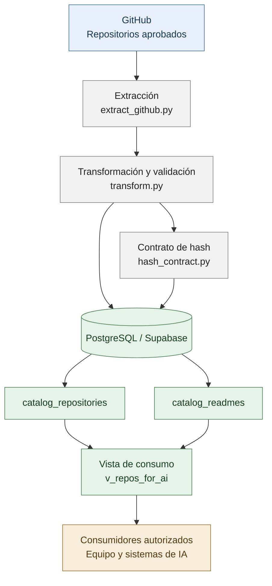
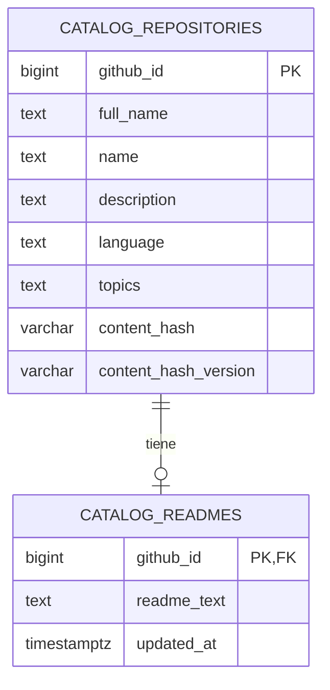

# OpenBridge

**Arquitectura de datos para el catálogo de repositorios de GitHub y su integración con inteligencia artificial.**

OpenBridge es un proyecto de ingeniería de datos orientado a recopilar, transformar, validar y organizar información de repositorios de GitHub para facilitar su consulta y posterior integración con sistemas de inteligencia artificial.

La información se almacena en PostgreSQL mediante Supabase. La arquitectura separa los metadatos de los repositorios, el contenido de sus archivos README y la interfaz de consulta utilizada por los consumidores de datos.

## 1. Arquitectura general

La arquitectura lógica de OpenBridge está organizada en cuatro capas:

### Responsabilidad de cada capa

**1. Fuente de datos**

GitHub proporciona los metadatos de los repositorios aprobados y el contenido de sus README.

**2. Procesamiento**

Los módulos de extracción y transformación organizan los registros y validan su estructura. El módulo de hash implementa el contrato de identificación del contenido.

**3. Persistencia**

Supabase PostgreSQL almacena la información en dos tablas relacionadas. El catálogo conserva los metadatos y su huella de contenido; la tabla de README conserva el texto correspondiente.

**4. Consumo**

La vista `public.v_repos_for_ai` presenta los campos seleccionados de ambas tablas mediante una interfaz de lectura común para los consumidores autorizados.

El flujo representa la arquitectura lógica del proyecto; no implica que exista una API desplegada ni que todos los pasos de carga se ejecuten automáticamente.

## 2. Modelo entidad-relación

El modelo de datos principal contiene dos entidades persistentes: `catalog_repositories` y `catalog_readmes`.

El diagrama muestra las columnas principales para comprender el modelo, no la totalidad de las columnas físicas de `catalog_repositories`.

### 2.1. `catalog_repositories`

Es la entidad central del catálogo. Almacena los metadatos de cada repositorio, incluidos su identificador de GitHub, nombre completo, descripción, lenguaje, estadísticas y otros atributos disponibles.

Su clave primaria es `github_id`, que identifica de manera única cada repositorio.

Además de los metadatos, contiene dos campos importantes para el control del contenido:

- `content_hash`
- `content_hash_version`

### 2.2. `catalog_readmes`

Almacena el contenido textual de los README asociados a los repositorios.

Sus columnas principales son:

| Columna | Función |
|---|---|
| `github_id` | Clave primaria y clave foránea hacia `catalog_repositories.github_id`. |
| `readme_text` | Contenido textual del README. |
| `updated_at` | Fecha y hora de actualización registrada. |

La clave foránea garantiza que cada README esté asociado a un repositorio existente. La restricción `ON DELETE CASCADE` establece que eliminar un repositorio elimina también su registro de README.

La relación permite que los metadatos y el documento descriptivo se administren por separado, pero se consulten conjuntamente.

## 3. Contrato de hash de contenido

El hash es un componente central del modelo de datos porque permite representar de manera verificable el contenido procesado de un repositorio.

OpenBridge implementa un contrato basado en **SHA-256 sobre una representación JSON canónica del contenido del repositorio y su README**.

La implementación del contrato se encuentra en `src/hash_contract.py`.

### 3.1. Campos del contrato

| Campo | Tipo | Propósito |
|---|---|---|
| `content_hash` | `VARCHAR(64)` | Almacena la huella SHA-256 del contenido procesado. |
| `content_hash_version` | `VARCHAR(32)` | Identifica la versión del contrato utilizada para generar la huella. |

SHA-256 produce una huella hexadecimal de 64 caracteres. La versión del contrato permite distinguir las reglas de serialización y cálculo utilizadas en diferentes momentos.

### 3.2. ¿Por qué separar el hash de su versión?

El hash no debe interpretarse aisladamente de las reglas que lo producen.

Si cambia la selección de campos, la normalización de los valores o la representación JSON, el resultado puede cambiar incluso cuando el contenido original no haya experimentado un cambio significativo.

Por eso, la versión del contrato permite interpretar correctamente las huellas y evita asumir que dos hashes calculados bajo reglas diferentes son directamente comparables.

### 3.3. Contrato `openbridge-ai-v1`

La versión identificada en el esquema es:

`openbridge-ai-v1`

Esta versión corresponde al contrato de hash canónico documentado para OpenBridge.

El campo `content_hash_version` admite valores nulos para registros heredados cuya versión de contrato no está identificada. Un valor nulo no demuestra por sí mismo que el hash sea incorrecto; significa que su versión no está declarada.

En consecuencia, no deben asignarse versiones automáticamente ni recalcularse las huellas existentes sin una validación explícita del contrato.

### 3.4. Estado de los hashes

En la última validación registrada de la base de datos:

| Condición | Registros |
|---|---:|
| Repositorios con `content_hash` | 100 |
| Versión `openbridge-ai-v1` | 95 |
| Versión nula | 5 |

Estos valores representan el estado observado durante esa validación, no una garantía de que los datos permanezcan invariables.

### 3.5. Relación del hash con la carga de datos

El contrato de hash forma parte del proceso de validación y planificación de cargas.

Antes de utilizar una huella para decidir si un registro debe actualizarse, es necesario comprobar que el hash corresponde al contrato esperado. Los registros heredados requieren un tratamiento diferenciado.

El cargador actual mantiene una política conservadora para los registros existentes: no debe realizar actualizaciones automáticas de metadatos ni de README sin que el contrato de hash y las reglas de escritura estén aprobados.

## 4. Vista de consumo: `v_repos_for_ai`

La vista `public.v_repos_for_ai` constituye la interfaz de consulta de OpenBridge.

Combina los datos de `catalog_repositories` con el texto correspondiente de `catalog_readmes` mediante una unión por `github_id`.

La vista expone los siguientes campos:

- `github_id`
- `full_name`
- `name`
- `description`
- `homepage`
- `language`
- `topics`
- `stargazers_count`
- `forks_count`
- `pushed_at`
- `archived`
- `license_spdx_id`
- `content_hash`
- `readme_text`

El campo `topics` se proyecta como un arreglo de texto en la definición actual de la vista.

### ¿Por qué utilizar una vista?

La vista permite que los consumidores accedan a una representación consolidada sin tener que conocer los detalles de la relación entre las tablas.

Sus ventajas son:

- Mantener una interfaz de consulta estable.
- Evitar que cada consumidor implemente sus propias uniones entre tablas.
- Exponer únicamente los campos seleccionados para el consumo.
- Separar el modelo físico de almacenamiento del contrato de consulta.

La vista no almacena una copia independiente de todos los datos: consulta las tablas subyacentes.

**Nota sobre el contrato de consumo:** la vista expone actualmente `content_hash`, pero no `content_hash_version`. Si un consumidor necesita validar la versión del hash, ese requisito debe acordarse explícitamente antes de modificar la interfaz.

## 5. Acceso y seguridad

OpenBridge utiliza Supabase PostgreSQL como base de datos central.

Para la consulta rutinaria se creó y validó el usuario `openbridge_ai_reader`, con permisos limitados a la vista de consumo.

Según las comprobaciones realizadas, esta cuenta:

- Puede leer `public.v_repos_for_ai`.
- No tiene permisos de inserción, actualización ni eliminación.
- No tiene acceso directo a las tablas `catalog_repositories` y `catalog_readmes`.
- No puede crear objetos en el esquema.

Esta separación permite que los consumidores consulten los datos sin recibir permisos administrativos sobre el catálogo.

Las operaciones de escritura requieren una autorización independiente y un contrato de carga aprobado. La conexión de lectura no debe utilizarse para modificar la estructura ni los registros de la base de datos.

Las credenciales se administran fuera de este documento y no deben almacenarse en el repositorio.

## 6. Estado actual de la arquitectura

De acuerdo con las últimas validaciones registradas:

- La base de datos de Supabase está conectada.
- El catálogo contiene 100 repositorios.
- La tabla de README contiene 100 registros con contenido.
- La vista de consumo expone 100 registros.
- El contrato de hash está implementado y dispone de una versión identificada.
- El usuario de lectura fue creado y sus permisos fueron verificados.
- Las pruebas automatizadas registraron 186 resultados aprobados en la última ejecución documentada.

Estos resultados deben volver a comprobarse después de cambios en el esquema, las credenciales o el código.

### Componentes pendientes de evolución

La arquitectura puede ampliarse en etapas posteriores:

1. Definir el contrato de integración entre el catálogo y el componente de IA consumidor.
2. Establecer cómo se sincronizarán y validarán futuras actualizaciones del contenido.
3. Evaluar una API propia si se requiere centralizar autenticación, consumo y control de acceso para múltiples aplicaciones.
4. Versionar los cambios de esquema y documentar las decisiones de arquitectura.

La API es una posibilidad de evolución, no un componente que deba considerarse implementado actualmente.

## 7. Organización técnica del proyecto

Los módulos principales de ingeniería de datos se encuentran en `data-engineering/src/`:

| Módulo | Responsabilidad |
|---|---|
| `extract_github.py` | Extracción de información desde GitHub. |
| `transform.py` | Transformación y validación de los registros. |
| `hash_contract.py` | Implementación y validación del contrato de hash. |
| `load.py` | Comparación del estado transformado con el catálogo y planificación de carga. |
| `database.py` | Configuración del motor y conexión a PostgreSQL. |
| `config.py` | Configuración de la conexión y validación de sus parámetros. |

La separación por módulos facilita el mantenimiento y permite evolucionar la extracción, el contrato de hash y las políticas de carga de manera controlada.

---

**OpenBridge: un catálogo de datos estructurado, con relaciones explícitas, huellas de contenido versionadas y una interfaz de consulta controlada para su integración con inteligencia artificial.**
