<div align="center">

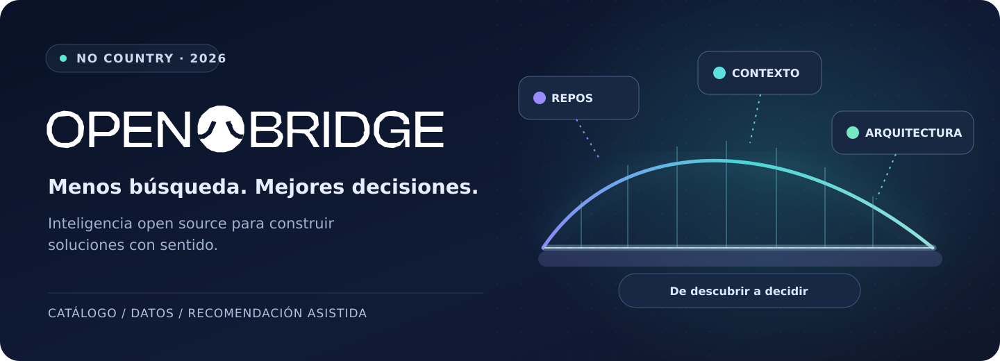

<br/>

**OPEN SOURCE DISCOVERY · AI-ASSISTED ARCHITECTURE · DEVELOPER TOOLS**

**Proyecto colaborativo · No Country 2026 · Vista de presentación / versión de prueba**

[**El desafío**](#el-desafio) · [**Producto**](#producto) · [**Arquitectura**](#arquitectura-propuesta) · [**Documentación**](#centro-de-documentacion) · [**Equipo**](#nuestro-equipo)

</div>

---

> ### Una mejor arquitectura comienza con mejores decisiones.
>
> **OpenBridge** plantea un puente entre el universo de herramientas open source y las necesidades reales de los equipos que construyen software. Descubrir, evaluar, conectar y recomendar: **menos tiempo explorando opciones dispersas; más criterio para crear productos.**

## El desafio

En el escenario definido por **No Country**, arquitectos y líderes técnicos dedican **entre 15 y 20 horas por proyecto** a investigar manualmente librerías, herramientas y servicios open source. Comparar información dispersa dificulta valorar mantenimiento, compatibilidad y posibilidades de integración.

**Nuestra oportunidad:** convertir múltiples fuentes técnicas en un recorrido de descubrimiento claro y recomendaciones contextualizadas.

> **Nota metodológica:** las 15–20 horas son un dato del [brief del desafío](docs/openbridge/docs/BRIEF_OFICIAL_NO_COUNTRY_OPENBRIDGE.pdf). No representan un ahorro medido ni un resultado obtenido por el equipo.

## La solucion

| | Capacidad propuesta | Valor para quien desarrolla |
|---|---|---|
| **01** | **Catálogo inteligente** | Descubrir proyectos según categoría, lenguaje, licencia y señales de mantenimiento. |
| **02** | **Fichas técnicas útiles** | Revisar métricas, actividad, licencias y posibilidades de uso. |
| **03** | **Integraciones con contexto** | Entender cómo conectar herramientas mediante API, SDK, Docker o webhooks. |
| **04** | **Asistente de arquitectura con IA** | Recibir alternativas de stack justificadas según el problema del negocio. |

**Alcance objetivo del desafío:** catálogo de al menos **100 repositorios**, filtros y búsqueda, ficha de salud del proyecto, ingesta automatizada desde GitHub y asistente con recuperación contextual (RAG).

> Estas capacidades son **objetivos de desarrollo**, no funcionalidades declaradas como terminadas.

<a id="producto"></a>
## Producto desplegado · Demo en Railway

**El proyecto se entiende mejor cuando se puede explorar.** El acceso principal lleva al frontend publicado en Railway por el equipo. Se conserva por separado el video de navegación real y los enlaces a la documentación para que cada recurso tenga un propósito claro.

<div align="center">

<a href="https://youtu.be/PYENf8whpNs" title="Ver el video del recorrido de OpenBridge en YouTube">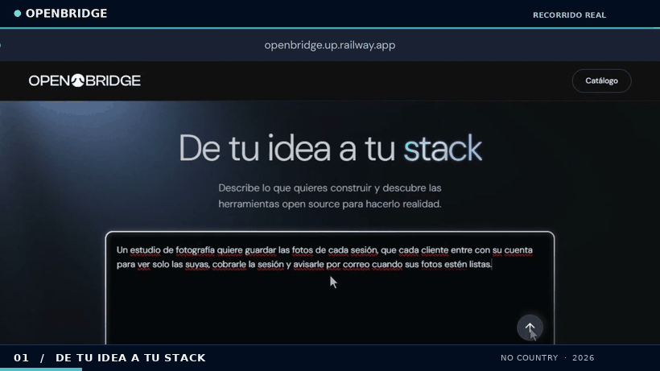</a>

<sub>**Evidencia visual:** el GIF resume ocho momentos de una grabación real del 27/10/2026. Al tocar la imagen se abre el video de YouTube compartido por el equipo. La copia MP4 del recorrido original permanece alojada en este GitHub.</sub>

<br />

<a href="https://youtu.be/PYENf8whpNs" title="Abrir el video del recorrido de OpenBridge en YouTube">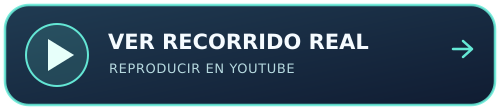</a>

<br />

<a href="https://openbridge.up.railway.app/" title="Abrir el frontend oficial de OpenBridge desplegado en Railway">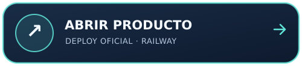</a>
<a href="https://openbridge.up.railway.app/#asistente" title="Abrir el asistente dentro del frontend de Railway">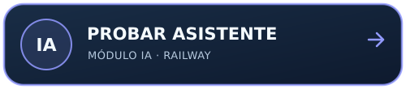</a>

</div>

<sub>**Accesos diferenciados:** «Ver recorrido real» abre el video publicado en YouTube; «Abrir producto» lleva al frontend de Railway y «Probar asistente» apunta a la sección `#asistente` del mismo sitio. El frontend actual también inicia en esa sección, por lo que ambos botones pueden mostrar inicialmente la misma pantalla. La guía de despliegue indica que Railway puede apagarse fuera de las demostraciones. <a href="https://github.com/No-Country-simulation/S10_26_EQUIPO_29/blob/deploy/docs/deploy-railway.md">Configuración oficial del deploy</a>.</sub>

<sub>**Evidencia:** el GIF y el MP4 proceden de una grabación auténtica enviada por el equipo y ya están alojados en este repositorio. En ella se observan la portada, navegación, catálogo, algunas fichas y filtros; **no demuestra una respuesta completa del asistente**, ni valida la exactitud de todos los datos. El funcionamiento puede cambiar durante el desarrollo.</sub>

### Recorrido de producto para quien evalúa

<table>
<tr>
<td width="33%" valign="top"><strong>01 · Explorá</strong><br />Abrí el despliegue del producto y observá su navegación e identidad visual.</td>
<td width="33%" valign="top"><strong>02 · Identificá</strong><br />Revisá las funciones disponibles y distinguí las ya integradas de las previstas en el desafío.</td>
<td width="33%" valign="top"><strong>03 · Probá el asistente</strong><br />Ingresá a la <a href="https://openbridge.up.railway.app/#asistente">sección del asistente</a> para evaluar su comportamiento en esta versión.</td>
</tr>
</table>

**Recorrido del producto:** [Reproducir en YouTube](https://youtu.be/PYENf8whpNs) · [Copia del recorrido original en GitHub (MP4, 57 s)](docs/openbridge/assets/showcase/OpenBridge_Recorrido_Real_57s.mp4) · [Vista previa animada (GIF)](docs/openbridge/assets/showcase/OpenBridge_Recorrido_Real.gif) · [Captura estática real (PNG)](docs/openbridge/assets/showcase/OpenBridge_Portada_Real.png). El README continúa siendo el punto central de acceso, y los recursos de respaldo están dentro del repositorio. La disponibilidad y duración exacta del video en YouTube no pudieron comprobarse automáticamente. [Evidencia y límites de la grabación](docs/openbridge/docs/09_RECORRIDO_REAL_Y_VIDEO.md) · [Protocolo de grabación](docs/openbridge/docs/08_DEMO_Y_RECORRIDO.md).

### Documentación vinculada al avance

<div align="center">

<a href="docs/openbridge/docs/BRIEF_OFICIAL_NO_COUNTRY_OPENBRIDGE.pdf" title="Abrir brief original en PDF dentro de este repositorio">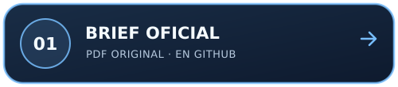</a>
<a href="docs/openbridge/docs/README.md" title="Abrir índice de documentación en este repositorio">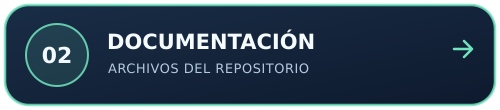</a>

<br />

<a href="https://github.com/orgs/No-Country-simulation/projects/566" title="Abrir tablero oficial del equipo en GitHub Projects"></a>
<a href="docs/openbridge/docs/15_SEGUIMIENTO_Y_CONTROL_PM.md" title="Abrir seguimiento documental y pendientes del PM">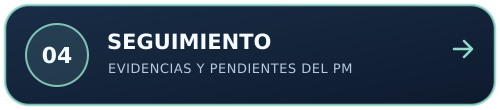</a>

</div>

**Lectura técnica complementaria:** [Arquitectura propuesta](#arquitectura-propuesta) · [Recorrido para la demo](docs/openbridge/docs/08_DEMO_Y_RECORRIDO.md) · [Centro de documentación](#centro-de-documentacion).

<sub>**Documentación centralizada:** el brief original, las evidencias y los informes están alojados en la carpeta <a href="docs/openbridge/docs/README.md"><code>docs/</code> de este repositorio</a>. El tablero operativo está en GitHub Projects de No Country y puede requerir permisos de la organización.</sub>

---

## De una idea a una arquitectura

**Ejemplo ilustrativo, no una demostración del software:**

**Necesidad:** «Estoy creando un e-commerce B2B para operaciones logísticas».

```text
NECESIDAD DEL NEGOCIO
        │
        ▼
CONTEXTO + REQUISITOS
        │
        ▼
CATÁLOGO DE REPOSITORIOS
        │
        ▼
RELEVANCIA + MANTENIMIENTO + LICENCIA
        │
        ▼
STACK SUGERIDO + PATRONES DE INTEGRACIÓN
        │
        ▼
EXPLICACIÓN Y REVISIÓN HUMANA
```

El sistema debe apoyar decisiones técnicas, no reemplazar la evaluación de seguridad, licencias, costos, soporte o compatibilidad.

## Arquitectura propuesta

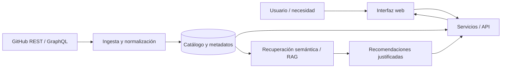

**Puntos de diseño pendientes de validar:**

- Estrategia de sincronización y límites de las API de GitHub.
- Modelo de indicadores de salud y actualización del repositorio.
- Recuperación semántica, calidad de las fuentes y trazabilidad de recomendaciones.
- Estructuración de integraciones, compatibilidad y ejemplos reproducibles.
- Contrato frontend/backend, pruebas, despliegue y seguridad.

**Tecnologías:** el desafío sugiere Next.js/React, FastAPI o Node.js, PostgreSQL/pgvector o Qdrant y herramientas para RAG. **Ninguna de estas alternativas se declara aquí como tecnología implementada sin validación del equipo.**

## Centro de documentación

> **Acceso centralizado:** el brief original y la documentación de OpenBridge viven en la carpeta [`docs/`](docs/openbridge/docs/README.md) de **este mismo repositorio**. La gestión activa de tareas se realiza en el [GitHub Project #566 del equipo](https://github.com/orgs/No-Country-simulation/projects/566), cuyo acceso puede depender de permisos de organización.

| Fuente | Qué permite consultar |
|---|---|
| [**01 · Brief oficial de No Country — PDF**](docs/openbridge/docs/BRIEF_OFICIAL_NO_COUNTRY_OPENBRIDGE.pdf) | Documento original del desafío: alcance, entregables y tecnologías sugeridas. |
| [**02 · Índice de documentación**](docs/openbridge/docs/README.md) | Biblioteca interna con informes técnicos, evidencias y contribuciones por rol. |
| [**03 · Gestión del proyecto — GitHub Projects**](https://github.com/orgs/No-Country-simulation/projects/566) | Tablero operativo compartido por el equipo para tareas, responsables y estados. |
| [**04 · Seguimiento y control de PM**](docs/openbridge/docs/15_SEGUIMIENTO_Y_CONTROL_PM.md) | Registro documental de avances, evidencias y pendientes; no sustituye el tablero vivo. |
| [**Backend + IA · Síntesis ejecutiva**](docs/openbridge/docs/11_RESUMEN_EJECUTIVO_BACKEND_IA_CONTRIBUCIONES.md) | Arquitectura, pruebas y participación de Fabián en Frontend. |
| [**Data Engineering · Jeison Pinzón**](docs/openbridge/docs/12_DATA_ENGINEERING_JEISON_127_REPOSITORIOS.md) | Sincronización de 127 repositorios y control de integridad. |
| [**Inteligencia Artificial · Andrés Iglesias**](docs/openbridge/docs/13_IA_ANDRES_EVALUACION_Y_CONTRIBUCIONES.md) | Evaluación, búsqueda semántica, riesgos y contribuciones del área IA. |
| [**Project Management · David Vergara**](docs/openbridge/docs/14_PROJECT_MANAGEMENT_DAVID_VERGARA_CIERRE.md) | Daily por Discord, coordinación de tareas, habilidades y documentación. |
| [**Informe técnico completo · Backend e IA**](docs/openbridge/docs/10_BACKEND_ENTREGA_2026-11-11.md) | Desarrollo, endpoints, workflows, límites y pruebas documentadas. |
| [**Evidencias de demo**](docs/openbridge/docs/09_RECORRIDO_REAL_Y_VIDEO.md) | Video de recorrido real, ficha de evidencia y guía de publicación. |
| [**Repositorio oficial del equipo**](https://github.com/No-Country-simulation/S10_26_EQUIPO_29) | Código fuente, ramas y Pull Requests del desarrollo. |

**Alcance de la evidencia:** ya están vinculados el repositorio oficial, la captura real del producto, el recorrido en video y el documento técnico revisado el 11/11/2026. Las pruebas consignadas corresponden a esa revisión; todavía falta verificar desde un entorno externo el despliegue, las llamadas HTTP y la ejecución efectiva de los workflows.

### Integración técnica documentada

La revisión del **11 de noviembre de 2026** describe dos servicios HTTP de OpenBridge: una **API FastAPI de catálogo** que consulta PostgreSQL/Supabase en lectura (puerto local `8000`) y un **servicio FastAPI de asistente con IA** (puerto local `8001`). El frontend utiliza bases HTTP independientes para el catálogo y el asistente. El endpoint `POST /assistant` del catálogo es un placeholder; la generación corresponde al servicio de IA.

El informe registra **155 pruebas aprobadas** del catálogo y **596 aprobadas, con 3 omitidas**, de IA y contratos. Son resultados reportados en la revisión, **no una comprobación de disponibilidad del despliegue público**. La sincronización diaria del catálogo está configurada en modo **dry-run**; no debe presentarse como escritura automática de datos.

[**Leer la síntesis técnica y las contribuciones**](docs/openbridge/docs/11_RESUMEN_EJECUTIVO_BACKEND_IA_CONTRIBUCIONES.md) · [**Consultar el documento completo**](docs/openbridge/docs/10_BACKEND_ENTREGA_2026-11-11.md)

## Nuestro equipo

<div align="center">

### El talento detrás de OpenBridge

**Cuatro disciplinas. Un objetivo: transformar problemas reales en productos tecnológicos.**

Diseño, coordinación, inteligencia artificial y datos: conocé a las personas detrás de cada decisión.

</div>

<table>
<tr>
<td align="center" width="50%" valign="top">
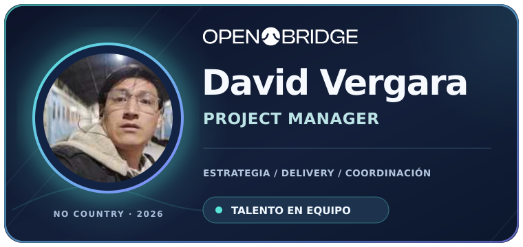
<br />
<strong>David Vergara</strong><br />
<sub>Project Manager</sub><br /><br />
<a href="https://github.com/marcketingdigital-cloud" title="Visitar GitHub de David Vergara"></a>
<a href="https://www.linkedin.com/in/jhonatanremon" title="Conectar con David Vergara en LinkedIn"></a>
</td>
<td align="center" width="50%" valign="top">
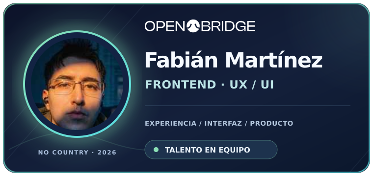
<br />
<strong>Fabián</strong><br />
<sub>Frontend · UX/UI</sub><br /><br />
<a href="https://github.com/fabianmartinezcaro" title="Visitar GitHub de Fabián"></a>
<a href="https://www.linkedin.com/in/fabianmartinezcaro/" title="Conectar con Fabián en LinkedIn"></a>
</td>
</tr>
<tr>
<td align="center" width="50%" valign="top">
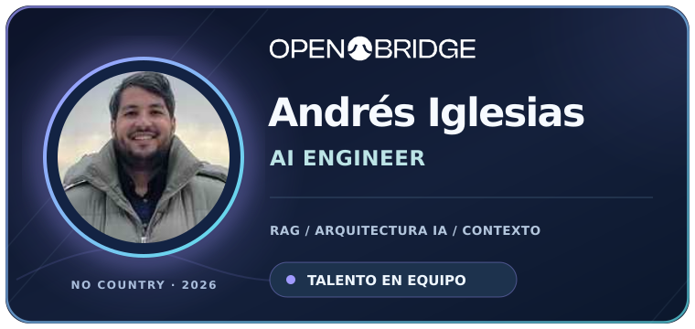
<br />
<strong>Andrés</strong><br />
<sub>Ingeniería de IA</sub><br /><br />
<a href="https://github.com/andigles" title="Visitar GitHub de Andrés"></a>
<a href="https://www.linkedin.com/in/andigles/es" title="Conectar con Andrés en LinkedIn"></a>
</td>
<td align="center" width="50%" valign="top">
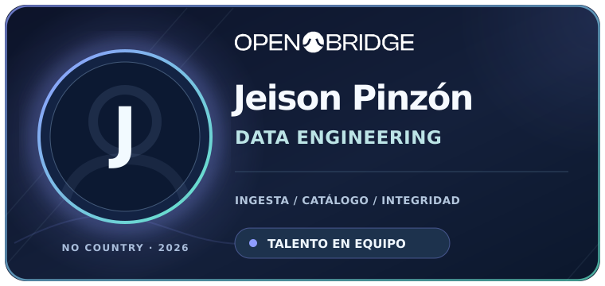
<br />
<strong>Jeison</strong><br />
<sub>Datos · Machine Learning</sub><br /><br />
<a href="https://github.com/Jeisz" title="Visitar GitHub de Jeison"></a>
<a href="https://www.linkedin.com/in/jeison-zapata-gpti" title="Conectar con Jeison en LinkedIn"></a>
</td>
</tr>
</table>

> **Identidad visual actualizada:** las tarjetas existentes ahora incorporan el logotipo original de OpenBridge; David, Fabián y Andrés tienen sus fotografías compartidas por el equipo, recortadas en círculos sin alterar sus rasgos. Jeison conserva un avatar provisional hasta recibir su fotografía. Los cuatro perfiles enlazan GitHub y LinkedIn; se mantienen únicamente las redes acordadas.

### Aporte destacado · Fabián Martínez

**UX/UI y Frontend.** Fabián tuvo a su cargo el diseño de la experiencia de usuario y la implementación del frontend. Su [PR #136](https://github.com/No-Country-simulation/S10_26_EQUIPO_29/pull/136), integrado a `main`, acredita mejoras en el sistema de diseño, tarjetas y fichas, estados del asistente y presentación del catálogo. Estos avances contribuyen a que las capacidades técnicas se expresen mediante una interfaz coherente y navegable.

> **Comentario del Project Manager:** «La contribución de Fabián fortaleció la identidad visual de OpenBridge y la manera en que las personas recorren el catálogo e interactúan con el asistente. Su dedicación a UX/UI y Frontend fue clave para transformar requisitos en una experiencia de producto más clara y consistente».
>
> — **David Vergara · Project Manager**

[**Ver la documentación del aporte y su relación con Backend e IA**](docs/openbridge/docs/11_RESUMEN_EJECUTIVO_BACKEND_IA_CONTRIBUCIONES.md).

**Aclaración sobre responsabilidades:** la documentación acredita el trabajo de Fabián en UX/UI y Frontend, pero no la autoría del Backend o del servicio de IA. Los responsables y acuerdos de integración deben contrastarse con las contribuciones del repositorio oficial.

### Aporte destacado · Jeison Pinzón

**Data Engineering e integración del catálogo.** Jeison trabajó en la extracción y normalización de información desde GitHub, la sincronización incremental y los controles de integridad del catálogo de **127 repositorios open source**. Sus contribuciones verificables también incluyen el [PR #65 sobre el contrato de fichas](https://github.com/No-Country-simulation/S10_26_EQUIPO_29/pull/65), el [PR #66 de la API Backend del catálogo](https://github.com/No-Country-simulation/S10_26_EQUIPO_29/pull/66) y el [PR #117 de integración de datos](https://github.com/No-Country-simulation/S10_26_EQUIPO_29/pull/117), integrado en `main`.

El informe de cierre recibido del equipo documenta una ejecución autorizada del **10 de noviembre de 2026**, con **127 registros actualizados, 31 README actualizados, cero inserciones y cero duplicados**, junto con **444 pruebas aprobadas** del conjunto Ingesta + Backend + Contratos. La operación de actualización de IA para **28 entradas** quedó pendiente en ese informe; su estado posterior debe confirmarse con el área de IA.

> **Comentario del Project Manager:** «La contribución de Jeison fue fundamental para consolidar una base de datos confiable y estructurada para OpenBridge. Destaco especialmente su compromiso con la calidad de la información, la seguridad de las operaciones y la coordinación técnica con las demás áreas. Su trabajo fortaleció la arquitectura del proyecto y permitió avanzar hacia una plataforma más sólida, mantenible y preparada para evolucionar».
>
> — **David Vergara · Project Manager**

[**Ver análisis de Data Engineering, evidencias de sincronización y PR de Jeison**](docs/openbridge/docs/12_DATA_ENGINEERING_JEISON_127_REPOSITORIOS.md).

**Transparencia:** las cifras anteriores corresponden a informes y pruebas declaradas por el equipo, no a una auditoría remota ejecutada desde este README. El workflow diario del catálogo está configurado en **dry-run**, por lo que no implica escritura automática. La propuesta de despliegue de Jeison en el [PR #125](https://github.com/No-Country-simulation/S10_26_EQUIPO_29/pull/125) seguía sin integrarse al momento de esta revisión.


### Aporte destacado · Andrés Iglesias

**AI Engineer y arquitectura de recomendaciones.** Andrés diseñó e implementó la vertical de Inteligencia Artificial de OpenBridge: búsqueda semántica con embeddings, asistente que interpreta necesidades de negocio y recomienda un stack a partir del catálogo, enriquecimiento de fichas, ideas de integración y validación de resultados. Su trabajo también incluye evaluaciones reproducibles, defensas frente a algunos intentos de manipulación y actualización selectiva de datos de IA.

La [documentación final de IA, incorporada mediante el PR #141](https://github.com/No-Country-simulation/S10_26_EQUIPO_29/blob/main/ai/docs/documentacion-ia.pdf), registra una **prueba final sobre una versión del 8 y 9 de noviembre de 2026**: **69 % (123/177)** de necesidades recibieron una herramienta correcta, **73 % (41/56)** de acierto de búsqueda entre los tres primeros resultados y **5 segundos** de mediana de respuesta. Cuando la herramienta correcta ya estaba entre los candidatos, el asistente la eligió en **94 % (123/131)** de esos casos. **Este último porcentaje no representa el éxito general del asistente.**

> **Comentario del Project Manager:** «Destaco la contribución de Andrés por convertir el desafío de recomendar herramientas open source en una solución de IA estructurada, evaluable y vinculada al catálogo de OpenBridge. Su trabajo en búsqueda semántica, validación de recomendaciones y pruebas permitió mostrar avances con evidencia, reconocer limitaciones reales y orientar las siguientes mejoras. Esta perspectiva técnica fortaleció la colaboración entre IA, Datos y Frontend».
>
> — **David Vergara · Project Manager**

[**Consultar el análisis técnico, las pruebas y los PR de Andrés**](docs/openbridge/docs/13_IA_ANDRES_EVALUACION_Y_CONTRIBUCIONES.md).

**Transparencia:** la evaluación también identificó límites en bases de datos y reportes, recomendaciones que deben abstenerse cuando falta evidencia y ataques de manipulación que no se frenan siempre (**7 de 10** resistidos en la prueba). Los cambios integrados después de la medición necesitan nuevas pruebas finales antes de comunicar otro porcentaje de acierto. Los PR documentan implementación, no garantizan funcionamiento de un servicio remoto.

### Gestión y cierre de Project Management · David Vergara

**Rol: Project Manager.** David participó en las reuniones **Daily del equipo mediante Discord** y colaboró en la **coordinación y el seguimiento de tareas**, la comunicación entre especialidades y la preparación de la documentación para la entrega de OpenBridge. Su aporte también comprende recibir, organizar, sintetizar y compartir los materiales de Frontend, Data Engineering y AI Engineering, conectándolos con el README de presentación, las evidencias del producto y los enlaces a sus Pull Requests.

**Habilidades blandas aplicadas:** comunicación clara y escucha activa, organización y priorización, trabajo colaborativo, adaptabilidad, pensamiento crítico y responsabilidad en el seguimiento y la comunicación de avances. Se describen a partir de actividades del proyecto, no como certificaciones ni resultados personales medidos.

> **Comentario de cierre del Project Manager:** «Como Project Manager de OpenBridge, participé en las reuniones Daily por Discord y colaboré en la coordinación y el seguimiento de tareas del equipo. Mi aporte se centró en fortalecer la comunicación entre las áreas, organizar y compartir la documentación técnica recibida, dar visibilidad a los avances y preparar una presentación del producto con evidencias reales. El trabajo colaborativo me permitió poner en práctica la escucha activa, la organización, la adaptabilidad y la responsabilidad de reconocer los aportes de cada compañero y comunicar con claridad lo que aún requiere validación».
>
> — **David Vergara · Project Manager**

[**Ver documentación de gestión, responsabilidades, habilidades blandas y controles de cierre**](docs/openbridge/docs/14_PROJECT_MANAGEMENT_DAVID_VERGARA_CIERRE.md).

**Nota de transparencia:** la participación en las dailies y las tareas de coordinación se describen según lo informado por David; no se afirma una cantidad de reuniones, actas, métricas de productividad o decisiones individuales que no estén documentadas. La gestión del PM es distinta de la autoría del código de cada especialidad.

<a id="open-to-opportunities"></a>

<div align="center">

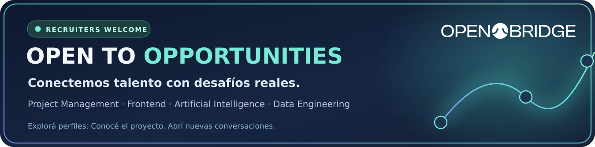

### ¿Reclutás talento para tu próximo proyecto?

**Conocé al equipo que está construyendo OpenBridge.** Explorá la propuesta, evaluá nuestras especialidades y conectá por GitHub o LinkedIn con perfiles identificados.

<a href="https://github.com/marcketingdigital-cloud/marcketingdigital-cloud/tree/main/proyectos/openbridge"></a>
<a href="https://github.com/marcketingdigital-cloud"></a>

<sub>La disponibilidad para oportunidades laborales debe ser confirmada por cada integrante. Los enlaces a GitHub y LinkedIn se vinculan a los perfiles compartidos por los integrantes.</sub>

</div>

## Estado y transparencia

| Dimensión | Estado en esta presentación |
|---|---|
| Problema de negocio y requisitos | **Documentados** en el brief. |
| Dirección del producto | **Propuesta definida**. |
| Coordinación y documentación | **Biblioteca documental en este repositorio**; tablero operativo en GitHub Projects. |
| Arquitectura | **Documentada** en la revisión técnica del 11/11/2026; despliegue remoto aún sin comprobación independiente. |
| Catálogo, asistente, ingesta y datos | **Código y pruebas documentados**; operaciones de despliegue, workflows y conexiones externas aún sujetas a verificación. |
| Despliegue en Railway | **Dominio oficial documentado por el equipo**; disponibilidad e integración real sujetas a prueba de humo. |
| Video de producto / GIF real | **Publicados en GitHub**; basados en navegación grabada por el equipo, sin demostración completa de respuesta del asistente. |
| README visual | **Versión de prueba publicada**, complementable por el equipo. |

## Camino hacia la demo

1. **Alinear alcance:** validar las funciones mínimas que se mostrarán.
2. **Construir un recorrido completo:** búsqueda → ficha → recomendación.
3. **Integrar y probar:** datos reales, contratos entre componentes y respuesta reproducible.
4. **Documentar con evidencia:** capturas, instrucciones de ejecución, resultados y limitaciones.
5. **Presentar al jurado:** demo, decisiones técnicas, aportes del equipo y próximos pasos.

---

<div align="center">

### Menos búsqueda. Mejores decisiones.

**OpenBridge** · Descubrir tecnologías es el comienzo; integrarlas con criterio es el objetivo.

[Inicio](#el-desafio) · [Producto](#producto) · [Documentación](#centro-de-documentacion) · [Equipo](#nuestro-equipo)

<sub>Simulación laboral No Country · Documento de presentación conceptual · Octubre de 2026</sub>

</div>