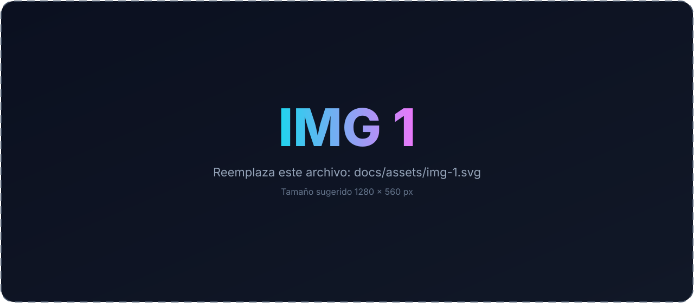
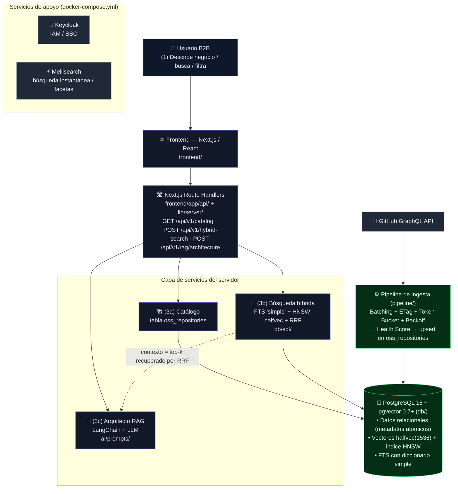
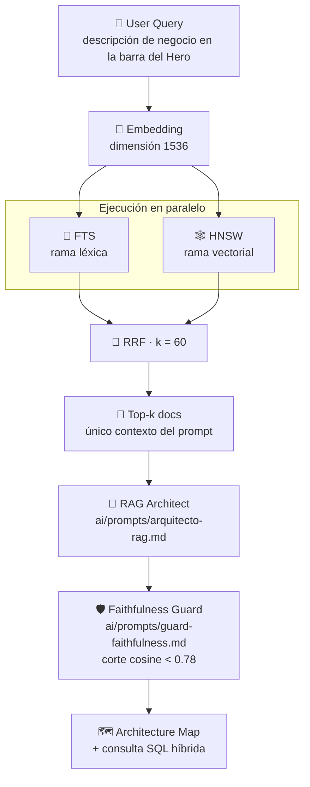
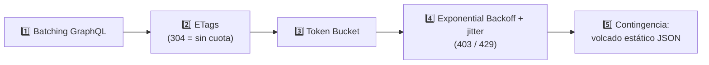
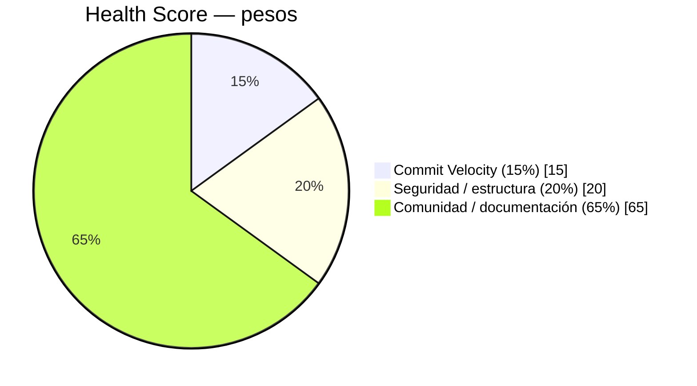
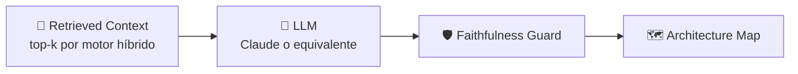
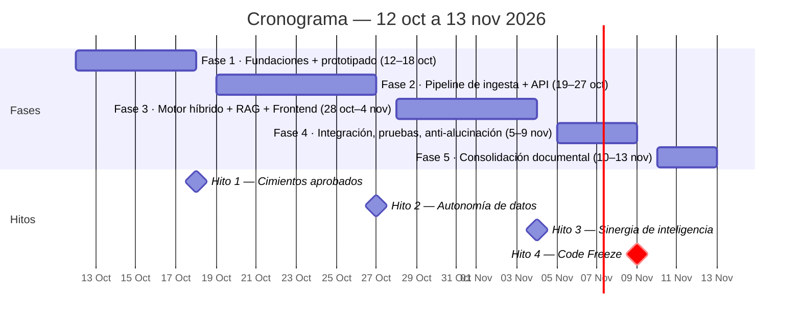

<h1 align="center">

  

</h1>

Marco: Simulación Laboral Abierta — NoCountry  ·  Ventana: 12 oct – 13 nov 2026 (32 días naturales)  ·  Code Freeze: 9 nov 2026 (Hito 4)

💡 En una frase

El Acelerador de Integraciones Open Source es una plataforma web interactiva que funciona como un catálogo curado e inteligente de tecnologías open-source, complementado por un asistente conversacional impulsado por IA que, ante una descripción de negocio, emite un mapa de arquitectura tecnológica justificado.

No es un directorio pasivo de repositorios.
| 🎯 Problema | 💡 Solución | 🧠 Inteligencia |
|:---|:---|:---|
| Líderes técnicos y arquitectos invierten entre 15 y 20 horas por cada nuevo proyecto investigando y validando herramientas, microservicios y librerías. La información está dispersa en GitHub, foros y listas de curación estáticas. | Una plataforma que cura y clasifica repositorios open-source (Auth, Bases de Datos, Pagos, IA) por categoría, licencia y salud estructural, y los traduce en fichas funcionales. | Búsqueda híbrida (FTS + pgvector HNSW + RRF) y un Arquitecto RAG que emite arquitecturas por capas, limitadas estrictamente al contexto recuperado. |

📊 Project at a glance

<table>

  <tr>

<td align="center" width="25%"><h2>122</h2>repositorios iniciales</td>

<td align="center" width="25%"><h2>4</h2>categorías (AUTH · DBS · PAYMENTS · AI)</td>

<td align="center" width="25%"><h2>9</h2>integrantes</td>

<td align="center" width="25%"><h2>32</h2>días naturales</td>
  </tr>

  <tr>

<td align="center"><h2>14 h/sem</h2>por miembro (capacidad neta)</td>

<td align="center"><h2>126 h/sem</h2>capacidad neta de equipo (9 × 14)</td>

<td align="center"><h2>P95 &lt; 250 ms</h2>latencia objetivo vectorial</td>

<td align="center"><h2>0.78</h2>cosine threshold (guard de fidelidad)</td>
  </tr>

  <tr>

<td align="center"><h2>k = 60</h2>constante RRF</td>

<td align="center"><h2>4</h2>métricas RAGAS</td>

<td align="center"><h2>1536</h2>dimensión del embedding</td>

<td align="center"><h2>27 + 5</h2>días de desarrollo técnico + colchón/documentación</td>
  </tr>

</table>

🧭 Tabla de contenidos
🧭 Overview
- 1. Resumen ejecutivo
- 2. Problema, solución y alcance (Regla 100% WBS)
🏗️ Architecture
- 5. Arquitectura del sistema
- 6. Modelo de datos
- 7. Búsqueda híbrida (pgvector + FTS + RRF)
- 8. Pipeline de ingesta y Health Score
- 9. Motor RAG (Arquitecto B2B)
- 13. Justificación del stack
🎨 Product
- 10. Frontend y catálogo
- 11. API (backend)
🧪 Quality
- 12. Evaluación RAGAS y prevención de alucinaciones
📋 Project Management
- 3. Equipo, capacidad y protocolo asíncrono
- 4. Matriz RACI
- 14. Cronograma: fases, hitos y colchón de contingencia
- 15. Matriz de riesgos
- 16. Entregables NoCountry (Tareas 1–4) y trazabilidad WBS
🚀 Getting Started
- 17. Puesta en marcha local
- 18. Estructura del repositorio
- 19. Seguridad, secretos y licencias
📚 Reference
- 20. Glosario
- 21. Fuentes y documentos base
- Control de cambios

📋 Ficha del proyecto
| Campo | Valor |
|:---|:---|
| Proyecto | Acelerador de Integraciones Open Source |
| Marco | Simulación Laboral Abierta — NoCountry |
| Ventana | 12 de octubre – 13 de noviembre de 2026 (32 días naturales) |
| Code Freeze | 9 de noviembre de 2026 (Hito 4) |
| Fase 5 (solo documentación) | 10 – 13 de noviembre de 2026 |
| Estado de este documento | Manifiesto arquitectónico — Tarea 1 (NoCountry) |
| Stack | React.js / Next.js (App Router, full-stack: UI + API Route Handlers) · PostgreSQL 16 + pgvector 0.7+ · LangChain · Docker · GitHub GraphQL API · RAGAS |
| Documento base de planificación | PMO_Project_Simulation_Planning.pdf (plan maestro PMO) |
| Prototipo frontend de referencia | frontend/app/page.tsx (componente OpenSourceAcceleratorPage) |

🧭 Overview
1. Resumen ejecutivo
El Acelerador de Integraciones Open Source es una plataforma web interactiva que funciona como un catálogo curado e inteligente de tecnologías open-source, complementado por un asistente conversacional impulsado por IA que, ante una descripción de negocio, emite un mapa de arquitectura tecnológica justificado.
No es un directorio pasivo de repositorios. El sistema combina:
| 📚 Catálogo estructurado | 🔎 Búsqueda híbrida | 🧠 Arquitecto RAG |
|:---|:---|:---|
| Metadatos atómicos, filtros por categoría, licencia y nivel de mantenimiento, y una puntuación de salud estructural (Health Score) por repositorio. | Une búsqueda léxica exacta (PostgreSQL full-text search) con búsqueda semántica vectorial (pgvector + HNSW) mediante Fusión de Rango Recíproco (RRF). | Recupera los componentes más relevantes con el motor híbrido, los inyecta en la ventana de contexto del LLM y emite arquitecturas por capas, con disparadores de integración, dependencias, licencias y justificación — limitadas estrictamente al contexto recuperado. |
El proyecto se ejecuta en 32 días naturales (12 oct – 13 nov 2026), con un equipo multidisciplinario distribuido y asíncrono de 9 personas, sin sobrecostes ni desbordamientos: el desarrollo técnico se comprime en 27 días (hasta el 9 de noviembre) y los 5 días restantes son colchón de contingencia + consolidación documental (ver §14).

2. Problema, solución y alcance (Regla 100% WBS)
2.1 El problema
En consultoría tecnológica B2B, el Time-to-Market y el costo de infraestructura determinan la viabilidad de las plataformas empresariales. Hoy, los líderes técnicos y arquitectos invierten entre 15 y 20 horas por cada nuevo proyecto investigando y validando herramientas, microservicios y librerías para evitar duplicar esfuerzos. Esa información está dispersa en repositorios de GitHub, foros especializados y listas de curación estáticas. Como consecuencia, las empresas pierden oportunidades de integrar desde las fases tempranas soluciones robustas, auto-hospedadas y gratuitas tales como Supabase, Keycloak o Meilisearch.
2.2 La solución
Una plataforma que:
1. Cura y clasifica repositorios open-source por categoría (Auth, Bases de Datos, Pagos, IA), licencia y salud estructural.
2. Traduce cada repositorio en una ficha funcional: descripción, comando Docker, disparadores de integración, dependencias, dificultad de integración y ahorro estimado frente a SaaS propietario.
3. Responde a descripciones de negocio complejas — por ejemplo, "una plataforma de comercio electrónico B2B orientada a la logística" — con un mapa de arquitectura por capas, justificado y sin alucinaciones.
2.3 Alcance y Regla 100% de la WBS
La planificación se rige por la Regla del 100% de la Estructura de Desglose del Trabajo (WBS): la WBS captura el 100% del trabajo definido por el alcance, sin adiciones superfluas (gold plating) ni omisiones. Todo el desarrollo técnico está subordinado a los cuatro entregables exigidos por la simulación (§16).
2.4 Fuera de alcance (explícito)
⛔ Out of scope

- No se construye un marketplace de SaaS propietario ni se revenden licencias.

- No se implementa facturación real ni procesamiento de pagos con dinero real (Hyperswitch se cataloga y se demuestra como componente, no se opera).

- No se entrena un LLM propio: se orquesta un modelo base existente (Claude o equivalente) mediante LangChain/LlamaIndex.

- No se añade funcionalidad nueva durante la Fase 5 (10–13 nov): esos 3 días son exclusivamente documentales.

📋 Project Management

3. Equipo, capacidad y protocolo asíncrono
3.1 Capacidad ágil
La planificación distingue esfuerzo de duración. Asumir 100% de utilización ignora ceremonias, fricción administrativa y contingencias. Se aplica un factor de enfoque (focus factor) del 70% sobre una dedicación teórica de 20 h/semana por persona (4 h/día × 5 días). El 30% restante cubre revisiones, reuniones asíncronas y coordinación.

20 h/sem × 70% = 14 h productivas por miembro

9 miembros × 14 h = 126 horas netas por semana (capacidad del equipo)

3.2 Inventario del equipo
| Miembro | Rol principal | Franja | Stack / herramientas dominantes | Habilidades clave | Capacidad neta |
|:---|:---|:---|:---|:---|:---:|
| David Vergara | Project Manager | 🌙 Noche (6pm–10pm) | Google Sheets | Arquitectura de software, patrones de diseño, conceptos Cloud | 14 h/sem |
| Fabián Martinez | UX/UI Designer | 🌙 Noche (6pm–10pm) | Figma, FigJam, Figma Dev Mode | Sistemas de diseño, diseño visual, Mobile UI/UX, Wireframing | 14 h/sem |
| Claudia A. Maucaylli | UX/UI Designer | 🌙 Noche (6pm–10pm) | Figma, Lovable | Pruebas de usabilidad, prototipado interactivo, Responsive Design | 14 h/sem |
| Justina Mutigliengo | Backend Developer | ☀️ Tarde (1pm–5pm) | Express.js, MongoDB, Node.js, PostgreSQL | Integración de APIs (REST), TypeScript, arquitectura de software | 14 h/sem |
| Jeison Pinzón | Data Engineer | 🌙 Noche (6pm–10pm) | Docker, Python, PostgreSQL | Ciencia de datos, Machine Learning, despliegue de contenedores, LLMs | 14 h/sem |
| Andres Iglesias | AI Engineer | ☀️ Tarde (1pm–5pm) | Python, FastAPI, scikit-learn, PyTorch | Tuberías de datos, CI/CD, procesamiento RAG, APIs de modelos base | 14 h/sem |
| Aleja Noriega | AI Engineer | 🌙 Noche (6pm–10pm) | Amazon S3 | Ingeniería de prompts, microservicios, LLM, patrones de diseño | 14 h/sem |
| Edison Peña | AI Engineer | 🌗 Tarde/Noche | ChatGPT Plus, Gemini Pro, Muse | Pruebas de modelos fundacionales, evaluación de IA, gestión de proyectos | 14 h/sem |
| Exequiel A. Pérez | Machine Learning Engineer | ☀️ Tarde (1pm–5pm) | Python, scikit-learn, Claude Code | Visualización de datos, flujos de ciencia de datos, evaluación | 14 h/sem |
Cuatro miembros operan en la tarde y cinco en la noche. Esa divergencia es la razón de ser del protocolo asíncrono (§3.3).

3.3 Protocolo de trabajo asíncrono — Traspaso de Bloque
El fracaso de los entornos asíncronos ocurre cuando el trabajo se reduce a "esperar respuestas en un chat". Por ello, cada vez que un desarrollador finaliza su turno, debe registrar un Traspaso de Bloque (End-of-block handoff) con cinco parámetros innegociables:
| # | Parámetro |
|:---:|:---|
| 1️⃣ | Qué se ha completado, con evidencia. |
| 2️⃣ | Qué alcance o suposición ha cambiado. |
| 3️⃣ | Qué dependencias bloquean el avance actual. |
| 4️⃣ | Cuál es la siguiente acción requerida (verbo, responsable y fecha límite). |
| 5️⃣ | Qué decisiones arquitectónicas deben retenerse. |
Este protocolo permite que el equipo nocturno (ej. Jeison Pinzón en bases de datos) continúe fluidamente el trabajo iniciado por el equipo de tarde (ej. Justina Mutigliengo en backend) sin interrupciones sincrónicas. La plantilla viva de este protocolo está implementada en el frontend (sección "Traspaso Asíncrono" de frontend/app/page.tsx).

4. Matriz RACI
Cada paquete de trabajo tiene un único Accountable (A). La asignación se ciñe a las habilidades validadas en el inventario del equipo (§3.2).
Leyenda: 🟦 R Ejecuta · 🟥 A Rinde cuentas · 🟨 C Consultado · ⬜ I Informado

| Paquete de trabajo (WBS) | 🟦 R (Ejecuta) | 🟥 A (Rinde cuentas) | 🟨 C (Consultado) | ⬜ I (Informado) |
|:---|:---|:---|:---|:---|
| Diseño y Sistema Visual (UI/UX) | Fabián Martinez, Claudia Maucaylli | Fabián Martinez | David Vergara | Todo el equipo |
| Arquitectura Relacional y Contenedores | Jeison Pinzón, Justina Mutigliengo | Jeison Pinzón | Andres Iglesias, David Vergara | Aleja Noriega |
| Pipeline de Ingesta y Evasión de Límites | Justina Mutigliengo, Andres Iglesias | Justina Mutigliengo | Jeison Pinzón, Exequiel Pérez | David Vergara |
| Búsqueda Híbrida Vectorial (pgvector) | Andres Iglesias, Jeison Pinzón | Andres Iglesias | Exequiel Pérez, Aleja Noriega | Justina Mutigliengo |
| Orquestación RAG y Evaluación de IA | Aleja Noriega, Exequiel Pérez, Edison Peña | Aleja Noriega | Andres Iglesias, Jeison Pinzón | Fabián Martinez |
| Integración Frontend (Next.js/React) | Fabián Martinez, David Vergara | David Vergara | Claudia Maucaylli, Justina Mutigliengo | Todo el equipo |
| Pruebas de Usabilidad y Calidad de RAG | Claudia Maucaylli, Edison Peña, Exequiel Pérez | Edison Peña | Aleja Noriega, Andres Iglesias | Project Manager |

🏗️ Architecture

5. Arquitectura del sistema
5.1 Vista general

<b>📜 Vista original en texto (referencia)</b>

Usuario B2B

   │ (1) Describe negocio / busca / filtra

   ▼

Frontend — Next.js / React (frontend/)

   │ (2) UI + API Route Handlers en la misma app:

   │     GET /api/v1/catalog · POST /api/v1/hybrid-search · POST /api/v1/rag/architecture

   ▼

Next.js Route Handlers (frontend/app/api/ + lib/server/)

   ├── (3a) Catálogo            → PostgreSQL (tabla oss_repositories)

   ├── (3b) Búsqueda híbrida    → FTS 'simple' + HNSW halfvec + RRF (db/sql/)

   └── (3c) Arquitecto RAG      → LangChain + LLM (ai/prompts/)

           │ contexto = top-k recuperado por RRF

           ▼

PostgreSQL 16 + pgvector 0.7+ (db/)

   ├── Datos relacionales (metadatos atómicos)

   ├── Vectores halfvec(1536) + índice HNSW

   └── FTS con diccionario 'simple'

           ▲

Pipeline de ingesta (pipeline/)

   └── GitHub GraphQL API → batching + ETag + Token Bucket + Backoff

                          → Health Score → upsert en oss_repositories

Servicios de apoyo (docker-compose.yml):

   Keycloak (IAM / SSO) · Meilisearch (búsqueda instantánea / facetas)

5.2 Flujo de una consulta RAG (camino crítico)

| Paso | Descripción |
|:---:|:---|
| 1 | El usuario escribe una descripción de negocio en la barra del Hero. |
| 2 | El backend genera el embedding de la consulta (dimensión 1536). |
| 3 | El motor híbrido ejecuta en paralelo la rama léxica (FTS) y la rama vectorial (HNSW), y fusiona con RRF (k=60). |
| 4 | Los top-k documentos recuperados se inyectan como único contexto en el prompt del Arquitecto RAG (ai/prompts/arquitecto-rag.md). |
| 5 | El LLM emite el mapa de arquitectura por capas. Cada afirmación debe estar respaldada por el contexto; si no lo está, el guard de fidelidad la suprime (ai/prompts/guard-faithfulness.md, corte cosine < 0.78). |
| 6 | La respuesta incluye la consulta SQL híbrida que respalda la selección, para que cualquier evaluador pueda reproducirla. |
5.3 Decisiones arquitectónicas retenidas
| Decisión | Valor | Razón (resumen) |
|:---|:---|:---|
| Base de datos única | PostgreSQL 16 + pgvector | Unifica relacional + vectorial; evita un segundo almacén |
| Precisión vectorial | halfvec (16 bits) | −50% RAM sin pérdida significativa de recall (Riesgo R5) |
| Índice vectorial | HNSW m=16, ef_construction=64 | Equilibrio recall/latencia; P95 < 250 ms |
| FTS | Diccionario 'simple' | Sin stemming Snowball; preserva SKU-9941A (Riesgo R4) |
| Fusión | RRF, k=60 | Fusiona rankings, no puntajes crudos incomparables |
| Ingesta | GraphQL + ETag + Token Bucket + Backoff | Respeta los límites de GitHub (Riesgo R1) |
| Orquestación IA | LangChain (o LlamaIndex) | Estándar del equipo; conecta búsqueda + LLM + evaluación |
| Evaluación | RAGAS (4 métricas) | Mide fallos independientes del conducto RAG |
Las ADR formales viven en docs/arquitectura/adr/.
🧱 Technology Stack
| Capa | Tecnologías |
|:---|:---|
| 🎨 Frontend |     |
| 🗄️ Data |      |
| 🧠 AI |    |
| 🏗️ Infrastructure |    |
| 🔌 Integration |  |

6. Modelo de datos
6.1 Tabla principal: oss_repositories
Definición ejecutable en db/sql/02_schema.sql. Los metadatos son campos atómicos (no conglomerados JSON) para soportar filtrado por categoría, lenguaje y licencia sin degradar la indexación.
| Campo | Tipo | Descripción |
|:---|:---|:---|
| id | UUID PK | Identificador interno |
| name | TEXT | Nombre visible (ej. "Keycloak Enterprise IAM") |
| slug | TEXT UNIQUE | keycloak/keycloak |
| category | TEXT | AUTH | DBS | PAYMENTS | AI |
| license | TEXT | MIT | Apache-2.0 | PostgreSQL | BSL-1.1 |
| description | TEXT | Descripción funcional |
| content | TEXT | Texto indexable por FTS |
| stars | INTEGER | Estrellas en GitHub (referencia) |
| health_score | NUMERIC(5,2) | Puntuación agregada (0–100) |
| commit_velocity_score | NUMERIC(5,2) | Sub-puntuación actividad (peso 15%) |
| security_score | NUMERIC(5,2) | Sub-puntuación seguridad/estructura (peso 20%) |
| docs_score | NUMERIC(5,2) | Sub-puntuación comunidad/documentación (peso 65%) |
| docker_command | TEXT | Comando de arranque reproducible |
| integration_difficulty | TEXT | Baja | Media | Alta |
| triggers | TEXT[] | Disparadores funcionales (ej. OIDC JWT Bearer Issuance) |
| dependencies | TEXT[] | Dependencias (ej. PostgreSQL Store) |
| etag | TEXT | ETag de la última sincronización GitHub |
| embedding | vector(1536) | Embedding original (precisión completa) |
| embedding_halfvec | halfvec(1536) | Embedding operativo (índice HNSW) |
| created_at / updated_at | TIMESTAMPTZ | Auditoría |
6.2 Índices
| Índice | Sobre | Propósito |
|:---|:---|:---|
| B-tree | category | Filtro por categoría |
| B-tree | license | Filtro por licencia |
| B-tree | health_score DESC | Ordenamiento por salud |
| GIN | to_tsvector('simple', content) | FTS léxico |
| HNSW | embedding_halfvec | Búsqueda vectorial (halfvec) |
Definidos en db/sql/03_indexes_hnsw\.sql.
6.3 Normalización
Se aplica normalización relacional para preservar los metadatos de los repositorios extraídos y evitar la "desaparición" de documentos durante búsquedas filtradas: cada repositorio es una fila; cada atributo de filtrado es una columna; los vectores viven junto a la fila, no en un almacén separado.
6.4 Semilla inicial
El catálogo arranca con 122 repositorios distribuidos en 4 categorías (ver §10). Las semillas viven en db/seeds/.

7. Búsqueda híbrida (pgvector + FTS + RRF)

FTS  +  Vector Search  +  RRF  =  **Hybrid Search

7.1 Por qué híbrida
| Enfoque | 💪 Fortaleza | ⚠️ Limitación |
|:---|:---|:---|
| Vectorial | Captura intención conceptual y sinónimos. | Falla con términos exactos: un código como SKU-9941A o una sigla corporativa puede diluirse en el embedding. |
| Léxico (BM25/FTS) | Coincidencia exacta de identificadores y siglas. | Falla con sinónimos e intención conceptual ("búsqueda de códigos de carga" ≠ la cadena literal). |
| Híbrido | Ejecuta ambas ramas en paralelo y fusiona rankings. | — |
7.2 Rama léxica — FTS con diccionario 'simple'
PostgreSQL full-text search con to_tsvector('simple', ...): el diccionario 'simple' no aplica stemming Snowball, por lo que preserva identificadores técnicos alfanuméricos (SKU-9941A, siglas, nombres de repositorio). Sin esta decisión, el stemming estándar destruiría esos identificadores y devolvería cero resultados (Riesgo R4, §15).
7.3 Rama vectorial — HNSW + halfvec
Índice HNSW (Hierarchical Navigable Small World) sobre similitud del coseno, con vectores halfvec (media precisión, pgvector 0.7+): reduce el consumo de RAM en ~50% sin pérdida significativa de recall. Parámetros: m=16, ef_construction=64. Latencia objetivo: P95 < 250 ms (Riesgo R5, §15).
7.4 Fusión — Reciprocal Rank Fusion (RRF)
Las dos ramas producen puntajes en escalas incomparables, así que no se suman puntajes crudos: se fusionan clasificaciones relativas.
\[

\mathrm{rrf\\_score}(doc) = \frac{1}{k + \mathrm{rank}_{fts}(doc)} + \frac{1}{k + \mathrm{rank}_{vec}(doc)}

\qquad k = 60

\]

rrf_score(doc) = 1 / (k + rank_fts(doc)) + 1 / (k + rank_vec(doc))

k = 60   (constante de suavizado)

Si un documento queda alto en ambas ramas, la suma de sus recíprocos lo empuja agresivamente a la cima. Consulta ejecutable en db/sql/04_hybrid_search_rrf.sql (top-20 por rama, top-5 final).
7.5 Ejemplo verificable
Consulta: "plataforma B2B logística con SKU-9941A y SSO"

| Rama | Qué captura |
|:---|:---|
| 📝 FTS 'simple' | SKU-9941A exacto (sin stemming). |
| 🕸️ HNSW | La intención semántica ("rutas logísticas", "flotas"). |
| 🔀 RRF | Ordena: Supabase+pgvector → Keycloak → Meilisearch+LangChain → Hyperswitch — cada uno con rrf_score, lexicalMatch y vectorCosine visibles en la respuesta RAG. |

8. Pipeline de ingesta y Health Score
8.1 Límites de GitHub (el riesgo técnico mayor)
| API | Límite | Nota |
|:---|:---|:---|
| REST (autenticada) | 5.000 peticiones/hora | — |
| GraphQL (primario) | 5.000 puntos/hora | Costo en "puntos" por consulta |
| GraphQL (secundario) | 2.000 puntos/minuto | Punitivo ante patrones abusivos |
8.2 Arquitectura de evasión (Fase 2)
Implementada en pipeline/ (responsables: Justina Mutigliengo, Andres Iglesias):

1. Batching GraphQL: consolidar la extracción de datos relacionados en una única llamada, minimizando el costo en puntos.
2. Solicitudes condicionales con ETags: si el repositorio no cambió desde la última consulta, no se consume cuota (respuesta 304).
3. Token Bucket: limitador de tasa que regula el ritmo de envío.
4. Exponential Backoff con jitter: ante 403 o 429, pausar y aumentar progresivamente la espera antes del siguiente intento, evitando degradación del servicio y bloqueos permanentes.
5. Contingencia: si un bloqueo severo persiste, inyectar un volcado estático (JSON caché pre-ingestado) para que el frontend no se detenga (Riesgo R1, §15).
8.3 Health Score (algoritmo)
Responsable: Exequiel A. Pérez. Métrica ponderada que discrimina librerías mantenidas de abandonadas. Fórmula operativa (concreta los rangos del plan: actividad 10–15%, seguridad 15–20%):

Health Score = commit_velocity * 0.15

             + seguridad_estructural * 0.20

             + comunidad_documentación * 0.65

| Peso | Componente | Qué evalúa |
|:---:|:---|:---|
| 15% | 🚀 Commit Velocity (Actividad) | Frecuencia de commits, tasa de resolución de issues. |
| 20% | 🛡️ Security / Structure | Calidad estructural, vulnerabilidades. |
| 65% | 👥 Community / Documentation | Documentación, adopción, actividad comunitaria. |

Commit Velocity            ███░░░░░░░░░░░░░░░░░   15%

Security / Structure       ████░░░░░░░░░░░░░░░░   20%

Community / Documentation  █████████████░░░░░░░   65%

El valor agregado se almacena como campo relacional health_score (§6.1). Consulta en db/sql/05_health_score.sql. El Hito 2 exige ingestar >100 repositorios sin detonar bloqueos por límites de tasa.
8.4 Exposición vía API
La app Next.js expone los datos mediante Route Handlers (frontend/app/api/), que el frontend consume para el catálogo categorizado (§11). backend/ (FastAPI) queda como servicio Python opcional, solo si el equipo decide extraer el worker de ingesta/RAG; por defecto no se necesita para correr la app.

9. 🧠 Motor RAG (Arquitecto B2B)

9.1 Componentes
| Componente | Detalle |
|:---|:---|
| Orquestador | LangChain o LlamaIndex (backend/app/services/rag/) |
| Modelo | Claude o equivalente (modelo base, no entrenado por el equipo) |
| Prompts | ai/prompts/arquitecto-rag.md (sistema) y ai/prompts/guard-faithfulness.md (guard de fidelidad) |
| Contexto | Exclusivamente los top-k documentos recuperados por el motor híbrido (§7). Nada fuera de ese contexto puede aparecer en la respuesta. |
9.2 Reglas del prompt (resumen)
🔒 Anti-hallucination rules

- ✅ Context-only generation: responder únicamente con información del contexto recuperado.

- 🚫 Si el contexto no contiene la respuesta: declarar "No disponible en el contexto recuperado".

- 🚫 Nunca inventar librerías, dependencias, comandos Docker ni licencias.

- 📐 Formato: mapa por capas (Auth, DBs, AI, Payments) con herramienta, licencia, Health Score, justificación y disparador de integración.

- 🧾 Cerrar con la consulta SQL híbrida RRF que respalda la selección.

9.3 Guard de fidelidad
| Regla | Acción |
|:---|:---|
| Corte por similitud | Documentos con cosine < 0.78 → se descartan. |
| Fidelidad estimada < 1.00 | La respuesta se reduce a lo estrictamente respaldado. |
| Evaluación continua | RAGAS (§12) decide si endurecer el prompt o ajustar la recuperación. |
9.4 Escenarios B2B de referencia (prototipo)
El frontend implementa tres escenarios completos (B2B_RAG_SCENARIOS en frontend/app/page.tsx):
<table>

  <tr>

<td width="33%" valign="top">

  <h4>1️⃣ Comercio electrónico B2B orientado a la logística</h4>

  <b>Dominio:</b> Supply Chain &amp; B2B Logistics  

  <b>Capas:</b> Keycloak → Supabase+pgvector → Meilisearch+LangChain → Hyperswitch  

  <b>Faithfulness:</b> <code>1.00</code>

</td>

<td width="33%" valign="top">

  <h4>2️⃣ Infraestructura Fintech B2B &amp; conciliación bancaria</h4>

  <b>Dominio:</b> Enterprise Fintech  

  <b>Capas:</b> Hyperswitch → Keycloak → Supabase+pgvector → LangChain+RAGAS  

  <b>Faithfulness:</b> <code>1.00</code>

</td>

<td width="33%" valign="top">

  <h4>3️⃣ Plataforma SaaS B2B con Copiloto RAG auto-hospedado</h4>

  <b>Dominio:</b> LegalTech &amp; Enterprise SaaS  

  <b>Capas:</b> PostgreSQL+pgvector → LangChain+Meilisearch+RAGAS → Keycloak  

  <b>Faithfulness:</b> <code>1.00</code>

</td>
  </tr>

</table>

| Escenario | Dominio | Capas | Faithfulness |
|:---|:---|:---|:---:|
| Comercio electrónico B2B orientado a la logística | Supply Chain & B2B Logistics | Keycloak → Supabase+pgvector → Meilisearch+LangChain → Hyperswitch | 1.00 |
| Infraestructura Fintech B2B & conciliación bancaria | Enterprise Fintech | Hyperswitch → Keycloak → Supabase+pgvector → LangChain+RAGAS | 1.00 |
| Plataforma SaaS B2B con Copiloto RAG auto-hospedado | LegalTech & Enterprise SaaS | PostgreSQL+pgvector → LangChain+Meilisearch+RAGAS → Keycloak | 1.00 |
Cada escenario incluye executiveSummary, nodos con rrfScore, lexicalMatch, vectorCosine, rationale, integrationTrigger, métricas RAGAS y el snippet SQL correspondiente.

13. Justificación del stack (Stack Decision Matrix)
| Capa | Elección | Justificación | Alternativa descartada / nota |
|:---|:---|:---|:---|
| Frontend + API | Next.js / React + TypeScript + Tailwind (App Router, full-stack) | UI + API en la misma app; Route Handlers con Zod; SSR para un catálogo público | SPA pura: peor SEO y primera carga |
| Backend (opcional) | FastAPI (Python) — solo worker opcional | Se mantiene como opción si se extrae el worker Python de ingesta/RAG | No se necesita por defecto; la API principal es Next.js |
| Base de datos | PostgreSQL 16 + pgvector 0.7+ | Un solo motor relacional + vectorial; FTS nativo; halfvec; HNSW | Base vectorial dedicada: segundo almacén, más latencia y más superficie operativa |
| Orquestación IA | LangChain (o LlamaIndex) | Estándar del equipo; conecta recuperación + LLM + evaluación | Orquestación manual: reinventa manejo de contexto y streaming |
| Modelo | Claude o equivalente (modelo base) | Razonamiento + fidelidad a instrucciones; sin costo de entrenamiento | Entrenar un LLM propio: fuera de alcance, tiempo y presupuesto |
| Búsqueda instantánea | Meilisearch | Sub-50 ms, tolerancia a errores tipográficos, facetas | Solo Elasticsearch: más pesado para el catálogo inicial |
| IAM | Keycloak | SSO, OIDC/SAML, multi-tenant B2B, sin cobro por MAU | IAM propietario: costo por usuario y vendor lock-in |
| Contenedores | Docker | Reproducibilidad local/producción; pgvector/pgvector:pg16 | Instalación nativa: deriva entre entornos |
| Evaluación | RAGAS | Métricas estándar de RAG (precisión, recall, fidelidad, relevancia) | Solo pruebas unitarias: no miden calidad del razonamiento |
Inventario completo y declaración de herramientas en tools/HERRAMIENTAS.md (Tarea 3, §16).

🎨 Product

10. Frontend y catálogo
10.1 Stack y archivo principal
Next.js / React (App Router) con TypeScript y Tailwind.
| | |
|:---|:---|
| 📄 Archivo principal | frontend/app/page.tsx |
| 🧩 Componente | OpenSourceAcceleratorPage |
| 👥 Responsables de integración | Fabián Martinez y David Vergara (Figma Dev Mode → código) |
Secciones del prototipo:
| Sección | Descripción |
|:---|:---|
| 🦸 Hero | Barra de prompt interactiva + telemetría del motor (diccionario FTS, modo halfvec, constante RRF k) |
| 🗂️ CategoriesGrid | Cuadrícula de categorías |
| ⭐ FeaturedToolsCatalog | Catálogo de herramientas destacadas |
| 🧠 Arquitecto RAG | Mapa de arquitectura generado |
| 📋 Plan PMO (WBS) | Plan de trabajo |
| 🔁 Traspaso Asíncrono | Plantilla viva del Traspaso de Bloque (§3.3) |
10.2 Categorías (122 repositorios)
| Categoría | Nombre | Repos | Health prom. | Tecnologías clave |
|:---:|:---|:---:|:---:|:---|
| 🔐 AUTH | Identidad & Autenticación | 28 | 95.4 | Keycloak, ory/kratos, supertokens-core |
| 🗄️ DBS | Bases de Datos & Motores Híbridos | 34 | 98.1 | Supabase, pgvector 0.7+, Meilisearch |
| 💳 PAYMENTS | Orquestación de Pagos & Billing B2B | 19 | 92.8 | Hyperswitch, Lago Billing, KillBill |
| 🤖 AI | Orquestación RAG, Agentes & Evaluación | 41 | 96.2 | LangChain, LlamaIndex, Ragas Framework |
10.3 Fichas de herramientas (ejemplos destacados)
Cada ficha traduce el repositorio en: descripción, licencia, Health Score con desglose, estrellas, ETag de última sincronización, comando Docker, dificultad de integración, disparadores, dependencias y ahorro estimado frente a SaaS propietario.
| Herramienta | Categoría | Licencia | Health | Dificultad |
|:---|:---:|:---:|:---:|:---:|
| Supabase + pgvector (v0.7+ halfvec) | DBS | Apache-2.0 | 98 | Baja |
| Keycloak Enterprise IAM | AUTH | Apache-2.0 | 95 | Media |
| Meilisearch + LangChain RAG Orchestrator | AI | MIT | 96 | Baja |
| Juspay Hyperswitch B2B Router | PAYMENTS | Apache-2.0 | 93 | Media |
10.4 Filtros
- Por categoría (AUTH / DBS / PAYMENTS / AI / Todas).
- Por licencia (MIT / Apache-2.0 / Todas). El Video Demo debe mostrar explícitamente el filtrado por licencia MIT/Apache y por nivel de mantenimiento (§16).

11. API (Next.js Route Handlers)
Next.js App Router — la UI y la API viven en la misma app (frontend/). Documentación de cada ruta en su route.ts. Implementación del lado del servidor en frontend/lib/server/ (db.ts, search.ts, rag.ts); cliente del navegador en frontend/lib/api-client.ts.
| Método | Endpoint | Descripción | Fase |
|:---:|:---|:---|:---:|
|  | /api/health | Salud de la app + PostgreSQL + pgvector | 2 |
|  | /api/v1/catalog | Catálogo + filtros (categoría, licencia, salud) | 2 |
|  | /api/v1/hybrid-search | Búsqueda híbrida FTS + HNSW + RRF | 3 |
|  | /api/v1/rag/architecture | Mapa de arquitectura RAG | 3 |
|  | /api/v1/tools/{slug}/health | Health Score + desglose | 2 |
Contrato de respuesta de búsqueda híbrida: lista de documentos con repo_id, tool_name, rrf_score, lexicalMatch, vectorCosine, license, health_score.

🧪 Quality

12. Evaluación RAGAS y prevención de alucinaciones
La evaluación de un sistema RAG trasciende las pruebas convencionales: no basta con que el código compile; hay que medir la calidad del razonamiento y la pertinencia de la recuperación. El equipo de IA/ML (Iglesias, Pérez, Peña) aplica un marco análogo a RAGAS con cuatro métricas cardinales (§12.1), implementado en ai/evaluation/ragas/.
12.1 Métricas
| Métrica | Qué mide | Fallo que detecta |
|:---|:---|:---|
| Context Precision | ¿Recupera componentes relevantes y los ordena útilmente, sin ruido? | Recuperación ruidosa / mal ranking |
| Context Recall | ¿Recupera toda la información necesaria para responder? | Chunking que oculta información crítica |
| Answer Relevance | ¿La arquitectura aborda el problema planteado, sin divagar? | Respuestas fuera de tema |
## 🏆 Faithfulness (Fidelidad) — la métrica suprema

¿Qué mide? ¿Qué proporción de afirmaciones está respaldada por el contexto?

Fallo que detecta: Alucinaciones: dependencias / librerías inventadas.

Faithfulness es la métrica suprema para este proyecto: el Video Demo debe evidenciar ausencia de alucinaciones (§16, Tarea 2).

12.2 Regla de ajuste
| Diagnóstico | Acción |
|:---|:---|
| Alta fidelidad + bajo recall | Ajustar pgvector / configuración RRF. |
| Recuperación perfecta + baja fidelidad | Endurecer los limitadores del prompt. |
| Cualquiera de las dos con fallo | ⛔ No se avanza de fase sin corrección. |
12.3 Pruebas de usabilidad (en paralelo, Fase 4)
Claudia Maucaylli lidera pruebas de usabilidad en el frontend, verificando que los tiempos de respuesta asíncronos del LLM se reflejen con estados de carga visuales adecuados.

📋 Project Management (cont.)

14. Cronograma: fases, hitos y colchón de contingencia
14.1 Fases

| Fase | Días | Fechas | Contenido | Responsables clave |
|:---|:---:|:---:|:---|:---|
| 1. Fundaciones + prototipado | 1–7 | 12–18 oct | Docker + PostgreSQL + pgvector; esquema relacional; Design System + wireframes alta fidelidad en Figma | Jeison Pinzón, Justina Mutigliengo, Fabián Martinez, Claudia Maucaylli |
| 2. Pipeline de ingesta + API | 8–16 | 19–27 oct | Ingesta GraphQL resiliente; Health Score; endpoints FastAPI/Node | Justina Mutigliengo, Andres Iglesias, Exequiel Pérez |
| 3. Motor híbrido + RAG + Frontend | 17–24 | 28 oct–4 nov | Búsqueda híbrida RRF; LLM vía LangChain; integración Next.js | Andres Iglesias, Jeison Pinzón, Aleja Noriega, David Vergara |
| 4. Integración, pruebas, anti-alucinación | 25–29 | 5–9 nov | Evaluación RAGAS; pruebas de usabilidad; Code Freeze 9 nov | Edison Peña, Exequiel Pérez, Claudia Maucaylli |
| 5. Consolidación documental | 30–32 | 10–13 nov | Documentación, Video Demo, herramientas, enlaces. Sin código nuevo | Todo el equipo (Edison Peña + David Vergara lideran Tarea 1) |
14.2 Hitos de control (inmutables)
| Hito | Fecha | Criterio de aceptación |
|:---|:---:|:---|
| 🏁 Hito 1 — Cimientos aprobados | 18 oct | BD relacional desplegada e inicializada; wireframes de alta fidelidad aprobados, listos para código |
| 🏁 Hito 2 — Autonomía de datos | 27 oct | Pipeline extrae, procesa y almacena metadatos de >100 repositorios sin bloqueos por límites de tasa; endpoints REST operativos |
| 🏁 Hito 3 — Sinergia de inteligencia | 4 nov | Motor RRF enlazado con el LLM; interfaz Next.js consume respuestas sin retardos insostenibles |
| 🧊 Hito 4 — Code Freeze | 9 nov | Todo el código (backend, frontend, pipelines) congelado en main y desplegado; comienza la fase exclusivamente documental |
14.3 Colchón de contingencia (Buffer Management)
El desarrollo técnico real se comprime en 27 días (hasta el 9 nov). Los 5 días restantes son colchón estratégico:
- Días 28–29 (8–9 nov): amortiguan fricciones de integración; absorben retrasos por Riesgo R1 (bloqueos API GitHub) y R3 (calibración del LLM contra alucinaciones).
- Días 30–32 (10–13 nov): franja blindada de Fase 5. Desarrollo técnico suspendido por decreto; todo el ancho de banda se dedica a documentar, auditar y empaquetar los artefactos de ENTREGABLES.pdf.

15. Matriz de riesgos
Escala: Probabilidad 1 (muy baja) – 5 (muy alta); Impacto 1 (insignificante) – 5 (catastrófico).
Exposición = Probabilidad × Impacto. Todo riesgo con exposición ≥ 15 exige mitigación arquitectónica obligatoria y contingencia formal.

🔴 Exposición ≥ 15 (crítico) · 🟡 Exposición < 15

| ID | Riesgo | Causa raíz | Prob. | Imp. | Exp. | Mitigación | Contingencia |
|:---:|:---|:---|:---:|:---:|:---:|:---|:---|
| 🔴 R1 | Limitación y bloqueo por GitHub API | Consumo excesivo extrayendo historial de commits/issues; límites secundarios (2.000 pts/min GraphQL, ~900 pts REST) | 4 | 5 | 🔴 20 | ETags (sin polling), Token Bucket, Backoff exponencial con jitter | Volcado estático JSON caché pre-ingestado para no detener el frontend |
| 🔴 R2 | Desbordamiento de capacidad asíncrona | Traspasos reducidos a "esperar en el chat"; parálisis tarde↔noche | 4 | 4 | 🔴 16 | Factor de enfoque 70%; formato de traspaso obligatorio (Hecho, Cambiado, Bloqueado, Próxima acción) | Reducir alcance funcional de UI (posponer animaciones) para proteger el buscador RAG |
| 🔴 R3 | Alucinaciones severas del motor RAG | Fallo de Faithfulness: inventa librerías/dependencias sin resultados exactos | 3 | 5 | 🔴 15 | Evaluación RAGAS continua; instrucciones de detención rígidas si cosine cae bajo umbral | Un día exclusivo de afinación de instrucciones (Fase 4) |
| 🟡 R4 | Corrupción léxica de búsquedas técnicas | Stemming Snowball destruye identificadores (SKU123, siglas) → cero resultados léxicos | 4 | 3 | 12 | Diccionario 'simple' en to_tsvector (sin stemming destructivo) | — |
| 🟡 R5 | Agotamiento de memoria por índice HNSW | Grafos de alta dimensión exceden shared_buffers → lecturas de disco, latencia > 250 ms | 3 | 4 | 12 | Límite controlado de repositorios + halfvec (pgvector 0.7+) | — |

16. Entregables NoCountry (Tareas 1–4) y trazabilidad WBS
<table>

  <tr>

<td width="50%" valign="top">

  <h3>📘 Tarea 1 — Documentation</h3>

  <b>Documentación del Proyecto (Markdown)</b> 

  Origen WBS: Fases 1, 2 y 5  

  Este archivo (<code>README.md</code>) + <code>docs/</code> como manifiesto arquitectónico. Debe explicar el modelo híbrido (pgvector + FTS), el pipeline de ingesta (GraphQL vs. rate limit), el algoritmo Health Score y las justificaciones del stack (PostgreSQL, Next.js, LangChain).

</td>

<td width="50%" valign="top">

  <h3>🎥 Tarea 2 — Video Demo</h3>

  <b>Video Demo del Proyecto (YouTube)</b> 

  Origen WBS: Fases 3, 4 y 5  

  Registro audiovisual del producto terminado. Debe mostrar sin interrupciones: interfaz del catálogo, filtros (licencia MIT/Apache, nivel de mantenimiento) y una simulación completa (descripción de negocio → stack estructurado). La ausencia de alucinaciones debe ser evidente. Guion en <code>video-demo/guion/GUION.md</code>.

</td>
  </tr>

  <tr>

<td width="50%" valign="top">

  <h3>🧰 Tarea 3 — Tools</h3>

  <b>Herramientas del Equipo</b> 

  Origen WBS: Fases 1–4  

  Declaración de tecnologías subyacentes. Inventario exhaustivo en <code>tools/HERRAMIENTAS.md</code>: Figma (UI/UX), FastAPI/Node.js (Backend), PostgreSQL + pgvector (BD vectorial), LangChain (orquestador IA), Docker (contenedores) y modelos de lenguaje empleados.

</td>

<td width="50%" valign="top">

  <h3>🔗 Tarea 4 — Project Links</h3>

  <b>Enlaces del Proyecto</b> 

  Origen WBS: Fases 4 y 5  

  Matriz de acceso público en <code>docs/entregables/tarea4-enlaces/README.md</code>: repositorio central de GitHub (con sub-módulos de Frontend y Pipeline) y URL del entorno de producción donde la app esté hospedada y funcional para los evaluadores. Verificar accesibilidad antes de la presentación final.

</td>
  </tr>

</table>

🧵 Regla de trazabilidad: ninguna fase opera en el vacío. La ingesta (Fase 2) y el RAG híbrido (Fase 3) son precondiciones de un Video Demo (Tarea 2) que sea una herramienta de IA genuina y no un prototipo estático; la infraestructura (Fase 1) desemboca en los Enlaces Públicos (Tarea 4).

🚀 Getting Started

17. 🚀 Puesta en marcha local (Quick Start)
1. Clone

# Clonar (o descomprimir el ZIP en D:\MuseWorkspace)

git clone <url-del-repo> D:\MuseWorkspace\acelerador-integraciones-open-source

cd D:\MuseWorkspace\acelerador-integraciones-open-source

2. Configure environment

# Variables de entorno (nunca subir el .env.local real)

copy frontend\\.env.example frontend\\.env.local   # DATABASE_URL, ANTHROPIC_API_KEY, GITHUB_TOKEN

3. Start infrastructure

# Levantar infraestructura (PostgreSQL+pgvector, Keycloak, Meilisearch)

docker compose up -d

4. Run the app

# App Next.js (UI + API en la misma app)

cd frontend ; npm install ; npm run dev

🌐 Servicios locales
| Servicio | Endpoint |
|:---|:---|
| App (UI + API) | http://localhost:3000 — salud en /api/health |
| PostgreSQL | localhost:5432 (db acelerador) |
| Keycloak | http://localhost:8080 |
| Meilisearch | http://localhost:7700 |
🧪 Pruebas y semillas

pytest -q backend/tests pipeline/tests

- Semillas del catálogo: db/seeds/ (122 repositorios iniciales)
- Ver docs/arquitectura/ para las ADR y docs/pmo/ para el plan completo.

18. Estructura del repositorio

acelerador-integraciones-open-source/

├── .github/        # workflows CI/deploy, plantillas Issue/PR

├── frontend/       # Next.js / React full-stack — app/, app/api/, components/, lib/

├── backend/        # FastAPI OPCIONAL — worker Python (ingesta/RAG), no requerido por defecto

├── pipeline/       # Ingesta GitHub GraphQL + Health Score (src/, sql/, tests/, data/)

├── db/             # PostgreSQL + pgvector — migrations/, seeds/, sql/ (01–05)

├── ai/             # prompts/, evaluation/ragas/, embeddings/

├── design/         # figma/, wireframes/, design-system/

├── docs/           # pmo/, arquitectura/adr/, api/, base-datos/, rag/, ux/, entregables/

├── scripts/        # windows/ (Crear-Estructura.ps1) · unix/ (setup.sh)

├── video-demo/     # guion/, assets/, capturas/

├── tools/          # HERRAMIENTAS.md (Tarea 3)

├── .env.example  .gitignore  docker-compose.yml  Makefile  LICENSE  CONTRIBUTING.md

└── README.md       # Este documento — Tarea 1

Cada carpeta vacía lleva un .gitkeep porque Git no versiona carpetas vacías.

19. 🔐 Seguridad, secretos y licencias
| Ámbito | Detalle |
|:---|:---|
| 🔑 Secretos | GITHUB_TOKEN, DATABASE_URL, LLM_API_KEY viven solo en .env local (ver .env.example). Nunca se suben al repo. Rotar el token de GitHub si se expone accidentalmente. |
| 🛡️ IAM | Keycloak con OIDC/SAML; JWT RS256 validado en el backend; Row-Level Security (RLS) por tenant_id en Supabase/PostgreSQL. |
| 📜 Licencias del catálogo | Cada herramienta conserva su licencia (MIT, Apache-2.0, PostgreSQL, BSL-1.1, etc.). Los filtros por licencia son parte del criterio de aceptación del Video Demo. |
| ⚖️ Licencia de este proyecto | MIT (ver LICENSE). |

📚 Reference

20. Glosario
| Término | Significado |
|:---|:---|
| RAG | Retrieval-Augmented Generation: generar con contexto recuperado, no de memoria del modelo |
| RRF | Reciprocal Rank Fusion: fusión de rankings, 1/(k+rank) |
| HNSW | Hierarchical Navigable Small World: índice aproximado de vecinos más cercanos |
| halfvec | Vector de media precisión (16 bits) en pgvector 0.7+ |
| FTS | Full-Text Search de PostgreSQL |
| ETag | Etiqueta de entidad HTTP para solicitudes condicionales (evita consumir cuota si nada cambió) |
| Token Bucket | Algoritmo limitador de tasa basado en "cubeta" de tokens |
| Backoff exponencial | Espera creciente tras cada fallo (403/429), con jitter aleatorio |
| Health Score | Puntuación ponderada de salud estructural de un repositorio |
| RAGAS | Marco de evaluación de sistemas RAG (precisión, recall, fidelidad, relevancia) |
| WBS | Work Breakdown Structure (Estructura de Desglose del Trabajo) |
| RACI | Responsible / Accountable / Consulted / Informed |
| Code Freeze | Congelamiento total de código (9 nov 2026) |
| Handoff | Traspaso de Bloque asíncrono (5 parámetros, §3.3) |

21. Fuentes y documentos base
Documentos del marco de simulación (base normativa del plan):
- proyecto_simulacion_laboral_tablas-corregidas.pdf
- ENTREGABLES.pdf (Tareas 1–4)
- EQUIPO DE TRABAJO.pdf (inventario de competencias y disponibilidad)
Referencias técnicas citadas en el plan maestro PMO:
- Asynchronous Project Management: Protocol and Handoff Templates (Altirya)
- Agile Capacity Planning (Teamwork; Float)
- WBS según la Guía PMBOK (Project Management Prepcast; Institute of Project Management)
- Understanding GitHub API Rate Limits: REST, GraphQL, and Beyond (GitHub Community)
- Rate limits and query limits for the GraphQL API (GitHub Docs)
- Build a Hybrid Search Engine with pgvector & FastAPI (Ismartanji)
- pgvector Hybrid Search: a Working Example — RRF + FTS (Rivestack)
- Getting Started with pgvector (Devart); Turning PostgreSQL Into a Vector Database (Tiger Data)
- Metadata Filtering and Hybrid Search for Vector Databases (DataQuest)
- Repository Health Score (Metrics-Count; RepoPulse)
- Evaluating RAG Systems — RAGAS, Faithfulness, Relevance (Medium; Ragas Docs; Atlan; Confident AI)
📌 Nota de integridad: este README sintetiza fielmente el plan maestro PMO y el prototipo frontend entregados. Donde el plan daba rangos (ej. pesos del Health Score), la fórmula operativa (§8.3) los concreta en los valores implementados en db/sql/ y frontend/app/page.tsx (15% / 20% / 65%). Cualquier divergencia futura debe resolverse por ADR en docs/arquitectura/adr/, no editando este manifiesto en silencio.

📝 Control de cambios
| Versión | Fecha | Cambio |
|:---:|:---:|:---|
| 1.0 | 15 oct 2026 | Manifiesto inicial Tarea 1: estructura del repo + resumen |
| 2.0 | 15 oct 2026 | Redacción completa con el contenido del plan maestro PMO: equipo, RACI, arquitectura, modelo de datos, búsqueda híbrida, ingesta, RAG, frontend, API, RAGAS, cronograma, riesgos y trazabilidad de entregables |

Acelerador de Integraciones Open Source · Simulación Laboral Abierta — NoCountry · Licencia MIT

