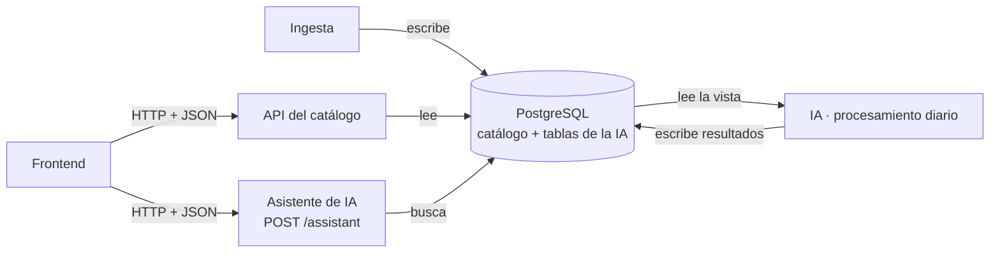

# OpenBridge — Acelerador de Integraciones Open Source

Proyecto del equipo **S10-26-equipo 29** en la simulación laboral de No Country (octubre–noviembre 2026).

OpenBridge es un catálogo de herramientas open source con ideas de integración, alimentado por una ingesta de repositorios de GitHub con métricas de salud, y un asistente con IA que recomienda un stack open source a partir de la descripción de un negocio.

**Estado:** en desarrollo (semana 2 de 4). Demo final: 13 de noviembre de 2026.

## Equipo

| Integrante | Rol |
|---|---|
| David Vergara | Project Manager |
| Jeison Pinzón | Data Engineer |
| Andrés Iglesias | AI Engineer |
| Fabián Martínez | UX/UI Designer · Frontend |

## Estructura del repositorio

Criterio: **lo que es de todos va en la raíz; lo que es de una parte va en su carpeta.** Cada parte es autosuficiente: tiene su propio README, sus dependencias y sus pruebas.

| Carpeta / archivo | Qué contiene | Responsable |
|---|---|---|
| `ingestion/` | Ingesta desde la API de GitHub, procesamiento y health score | Data Engineer |
| `backend/` | API del catálogo (FastAPI) | Data Engineer — *por confirmar* |
| `ai/` | Búsqueda semántica, asistente, categorías e ideas de integración con LLM, evaluación | AI Engineer |
| `frontend/` | Interfaz web | UX/UI Designer |
| `shared/contracts/` | Contratos entre partes: la forma de los datos que una parte produce y otra consume | Todos (cambios por PR, avisando) |
| `tests/` | Pruebas de **integración** entre partes; las de cada parte van en su carpeta | Todos |
| `docs/` | Documentación general del proyecto | Todos |
| `pm/` | Producto y gestión del proyecto | Project Manager |
| `.env.example` | Variables de entorno del proyecto, con una sección por parte | Todos |

## Estado por parte

| Parte | Hoy | Siguiente |
|---|---|---|
| Ingesta | En desarrollo en la rama `data-engineer` (exploración de fuentes, modelo relacional, vista para la IA) | Integración a `main` |
| IA | Catálogo de ejemplo sobre el contrato Repo v1.0; búsqueda semántica en curso | Medición de la búsqueda; asistente |
| Frontend | Interfaz con datos de prueba en el PR #20 | Conexión con la API y el asistente |
| Contratos | Repo v1.0 acordado (20-oct); Asistente e Idea de integración en revisión con frontend; lista de categorías provisional | Acuerdo con frontend; lista de categorías v1 |

Detalle de cada contrato: [`shared/contracts/README.md`](shared/contracts/README.md).

## Cómo se conectan las partes

- **La IA lee el catálogo** desde una vista de la base y **escribe sus resultados** (categorías, ideas, embeddings) en tablas propias.
- **La API del catálogo** entrega fichas y filtros al frontend, cruzando el catálogo con los resultados de la IA.
- **El asistente** es un servicio propio de la IA: recibe la descripción de un negocio y devuelve un stack recomendado.
- Cada dueño elige el lenguaje y las librerías de su parte. Se acuerdan en equipo los **contratos**, la **infraestructura compartida** (PostgreSQL, Docker Compose) y el **despliegue**.
- Convenciones comunes: fechas en ISO 8601; las partes en Python usan Pydantic 2.x.

## Cómo contribuir

La forma de trabajo del equipo (ramas, Pull Requests, carpetas y contratos) está en [`CONTRIBUTING.md`](CONTRIBUTING.md).
